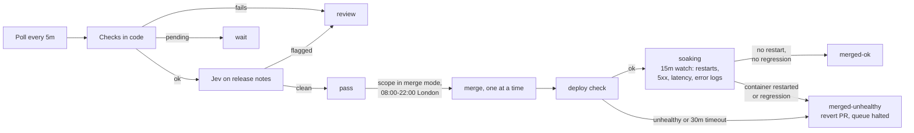

# Jevil

Jevil, `apps/jevil`, is the only thing that merges to `main`, for every pull request: a ruleset
blocks the GitHub merge button and `gh pr merge`, and you comment `/jevil merge` instead. It also
rules on every Chore Bore (Renovate) pull request, labels it, and on its own merges the ones its
policy passes, in groups whose deploys it checks together before the next. It acts on GitHub as
`jevil-bot[bot]`. Source: `github.com/member87/jevil` (private), image `ghcr.io/member87/jevil:<sha>`.

## What a pull request changes

Every open pull request, from anyone, has one Jevil **card**: a comment that leads with Jevil's
ruling (on Chore Bore updates) and a **TL;DR** saying why it has not merged and what happens next:
what held a passing update this poll, its place in the queue, or the merge commit. Below it,
collapsed sections each say their gist on one line: 📦 what this changes, 🔎 live diff, ✅/❌
checks, 🤖 Jev's reading, 🔎 upstream issues, 📜 changelog, 🗨️ the last `/jevil explain` or `/jevil status` output,
and 🕘 the history of other commands. Jevil edits the card only when its text changes, and it
carries Jev's cached answers. The merge lifecycle keeps its own comments, so each one notifies: the
queue comment (with its `⏳ Waiting…` line), dequeued, merged, live, upgrade progress and unhealthy.

**📦 What this changes**, kept up to date as commits land, maps each changed file onto what
deploys it:

| Target | When a file belongs to it | Deploys on merge |
|---|---|---|
| Flux Kustomization | under its `spec.path`; the most specific path wins (`infrastructure/metallb/config` over `infrastructure/metallb`) | yes |
| HelmRelease (Git chart) | under its chart directory (`apps/immich`, `charts/cert-manager`, ...) | only when `Chart.yaml` `version` changes; otherwise the comment says it deploys nothing |
| HelmRelease (its spec) | a change to the Kustomization that applies it (`flux/helm/<name>`: values, the OCIRepository tag) | yes: the release upgrades; an OCI chart to the tag the pull request sets |
| Terrakube workspace | under `terraform/<workspace>` | yes, Terrakube applies on merge |
| New app | under a new `apps/<app>` or `infrastructure/<x>` when the same pull request touches `flux/cluster` | yes, once Flux creates its Kustomization |
| tuppr upgrade | a `version:` bump in `infrastructure/tuppr/talos` or `/kubernetes` | yes: tuppr upgrades the nodes one at a time |
| Nothing | anything else (docs, scripts, `AGENTS.md`) | no |

The comment lists each target with the files under it and counts what will deploy. Under each Flux
target it shows the **object diff**: Jevil renders the Kustomization at the merge base and at the
head (kustomize, like kustomize-controller) and lists the objects added, removed and changed, with
the fields that change (`spec.template.spec.containers[name=grafana].image: 13.2.4 → 13.3.0`).
Under each HelmRelease the merge upgrades it shows the **rendered diff** the same way: Jevil
renders the chart in-process at both commits, like helm-controller (the chart from Git, its Helm
repository or its OCIRepository; dependencies fetched from their repositories; the release's
values; its `postRenderers`; this cluster's Kubernetes version and CRD APIs; `crds/` only when the
release sets `upgrade.crds: Create|CreateReplace`; hooks only when they run on upgrade). Values
from `valuesFrom` Secrets and ConfigMaps are left out (Jevil cannot read them) and the card says
so; fields that differ between two renders of the same commit (`randAlphaNum`, `genCA`) are left
out and counted. Secret and SealedSecret values are never shown. The merge comment, the deploy check
and the "now live" comment use the same targets.

**🔎 Live diff** compares with the running cluster rather than with the merge base, so it also shows
drift: something changed by hand, or a `main` change Flux has not applied yet. For every Flux target
Jevil renders `main` with the pull request merged in (each changed file taken from the head, or
line-merged where `main` changed it too; where the two conflict, GitHub's test merge if it is
current, else the head alone, and the section says so), reads each rendered object back from the
API server, and lists what applying would do:

- **changed**: the fields that differ. Only fields the manifests set are compared, plus fields
  Flux alone set before that the manifests now drop (from the object's `managedFields`), so server
  defaults, `status` and fields another manager also holds (Helm or Argo CD leftovers) never show.
  Quantities compare by amount (`1024Mi` is `1Gi`, `2000m` is `2`). Objects marked
  `kustomize.toolkit.fluxcd.io/ssa: IfNotPresent` or `Ignore` count as unchanged.
- **added**: not in the cluster yet, or of a kind the cluster does not serve yet (its CRD comes
  later).
- **removed**: in the Kustomization's inventory but no longer rendered, so pruning deletes it;
  **kept** when the Kustomization does not prune or the object is marked
  `kustomize.toolkit.fluxcd.io/prune: disabled`.
- **not readable**: a kind Jevil's `jevil-read-live` ClusterRole does not cover; add it to
  `apps/jevil/rbac.yaml`.

Secrets are never read: one the inventory already has is counted as "not compared", a new one is
listed as added. A SealedSecret shows which `encryptedData` keys change, never the values.
HelmReleases' charts are not rendered here; the HelmRelease object itself is compared like any
other. The diff is redone when the head changes or a Kustomization it deploys applies a new
revision, at least every 6 hours, and 5 minutes after a failed read. `liveDiff.maxBytes` in the
policy caps the section (6000 bytes); 0 turns it off.

## Checks

Every open pull request head gets the `jevil/checks` check-run (in the PR's Checks tab: conclusion,
the findings table, and an annotation on the file line of each finding Jevil can place: a secret's
line, or the `kind:` line of a plain manifest an object finding is about; objects only a Helm chart
renders and directory-level findings stay in the table) and a **Checks** table in the
same comment. ❌ findings block `/jevil merge`; ⚠️ findings are for you to read.

| Check | Blocks on | Warns on |
|---|---|---|
| `secret` | a known token format on an added line (GitHub, OpenRouter/OpenAI/Anthropic, AWS, private keys, Slack, Discord webhooks, Tailscale, age, `user:pass@` URLs); a long random value whose key Jev judges a credential (≥ 0.7) | Jev 0.3-0.7; diffs too large to scan |
| `validate` | a target that does not build; `flux/cluster` not building or pointing at a missing directory; a changed object failing its schema (kubeconform: this cluster's own CRD schemas first, refreshed hourly, then Kubernetes schemas, then the community CRD catalog for kinds the cluster does not have) | schemas that could not be fetched |
| `lint` | a container or init container without a memory limit; an unpinned or `:latest` image; a namespaced object without `metadata.namespace`; a Deployment mounting a ReadWriteOnce PVC (looked up in the rendered targets) without `strategy.type: Recreate`, so a rollout onto another node waits on Multi-Attach; a file `kustomization.yaml` does not reference; a chart directory changed without a `Chart.yaml` bump; Longhorn image overrides; an frpc proxy, edge Caddy site and `public_hostnames` entry that disagree (only what the pull request introduces; `# jevil:edge-local` exempts a proxy only the edge uses); a new IngressRoute with a route that neither goes through a forwardAuth middleware nor only redirects to HTTPS, in an app with no OIDC configuration (`# jevil:auth <why>` exempts); a Talos minor bump to v1.N while `talos/patches` holds a patch marked `# jevil:before-boot v1.N` (apply it on every node, then `--allow lint`); a Kubernetes minor bump of the KubernetesUpgrade (v1.N → v1.M) while any Kustomization, rendered at the pull request's head, has an object whose apiVersion v1.N serves and v1.M does not, read from each release's OpenAPI spec (`flowcontrol.apiserver.k8s.io/v1beta3` FlowSchema at v1.32: the finding names the object and what v1.M still serves; move it there, or `--allow lint`) | a new app with an IngressRoute missing from Glance; a dashboard or alert reading a metric the Prometheus keep-list drops; a Talos minor bump with no patch marked for it (read the upgrade notes); a Kubernetes minor bump whose release API specs could not be fetched, or a Kustomization that does not build, so the removed-API check did not run for it |
| `destructive` | removing a PVC, PV, Namespace, HelmRelease, StatefulSet, CRD, Kustomization or FluxInstance; changing an immutable field (PVC spec, workload selectors, StatefulSet `volumeClaimTemplates`/`serviceName`, Service `clusterIP`, ...); dropping `kustomize.toolkit.fluxcd.io/prune: disabled`; shrinking a PVC; deleting every manifest of a Kustomization; removing a LoadBalancer Service, or changing what holds a LoadBalancer address: `type: LoadBalancer`, `loadBalancerIP` or a MetalLB `loadBalancerIPs`/`allow-shared-ip`/`address-pool` annotation, on a Service or in a HelmRelease's values (the Pi-hole NodePort outage) | |
| `image` | a new image tag or digest the registry does not have. A missing image is asked about again every poll, so a pull request opened while its image still builds clears on its own once the image is pushed | a registry that could not be asked |
| `health` (at merge time) | | waits while a node is NotReady, an attached Longhorn volume is not healthy, a TalosUpgrade/KubernetesUpgrade is not Completed, a Kustomization other than the pull request's own targets is failing, or a cert-manager Certificate in a namespace the pull request deploys to is not Ready |
| `manual` | | a pull request touching `manualSteps.paths` (`infrastructure/`, `talos/`, `flux/`, the edge) that Jev, reading `AGENTS.md` and the diff, thinks needs a step by hand or a change elsewhere (≥ 0.5). Never asked when the secret check found anything, so a possible secret never leaves the cluster |

Only the changed objects are linted and validated, so an old problem elsewhere does not block an
unrelated pull request. Jev never sees a candidate secret's value: only the file, the key and the
value's shape (length, character classes, first three characters). Put `jevil:allow` in a comment
on a line to silence the secret check for it.

Probes (`lint`, warning only): a container the pull request adds or changes in a Deployment,
StatefulSet, DaemonSet or ReplicaSet, a native sidecar (`initContainers` with
`restartPolicy: Always`), or a pod spec written in a HelmRelease's values (a `containers` list
naming images, like ARC's runner `template`) with neither a `readinessProbe` nor a
`livenessProbe`. A container left as it was is not reported, so an image bump of an unprobed app
warns only for the container it bumps. `# jevil:no-probe <why>` anywhere in the object's own
YAML document exempts it (the reason is required; a marker in another document of the same file
does not count). The daily report lists every such workload on `main`.

Rendered HelmRelease objects get the `validate`, `lint`, `destructive` and `image` checks too, plus
a check that every apiVersion is one the running Kubernetes serves. A finding the release already
has before the change (an upstream container without a memory limit) is not the pull request's
doing and is left out; hooks are recreated on every upgrade, so their immutable fields may change.

The removed-API check is the exception: a Kubernetes minor bump makes every manifest's
apiVersion matter, so it renders every Kustomization and every HelmRelease's chart, not just the
pull request's targets.

After reviewing a finding, accept it for one merge with `--allow`:
`/jevil merge --allow destructive,image`. `--allow health` merges while the cluster is unhealthy.
A pull request touching a failing Kustomization or the tuppr manifests is exempt from those health
items, and so is a Kustomization failing only because it depends on one of the pull request's
targets (`dependency '...' is not ready`), so a fix can always merge. A not-Ready Certificate
has no such exemption (it is in the very namespace the fix deploys to): merge the fix with
`--allow health`. A namespace counts as deployed to when the target Kustomization's inventory
has an object in it (Flux's own objects in `flux-system` aside) or one of its HelmReleases
installs there.

## Merging a pull request: `/jevil merge`

Like the Aviator merge queue:

1. A login in `commanders` comments `/jevil merge` (optionally `--allow <checks>`). Jevil reacts 🚀,
   adds `queued` and replies with the head commit it queued (within a minute: it polls every
   `pollSeconds`).
2. Last readiness check, on a fresh read: the head is still that commit (a later push dequeues;
   comment again, except a Renovate rebase, below), not a draft, not on `hold`, into `main`, no merge conflict, no failing
   commit status or check-run, the required statuses or check-runs (`Terrakube - homeops - aws-edge`, `- grafana`, plus the
   workspace of any changed `terraform/<workspace>`) reported success, no blocking check finding
   outside `--allow`, and the cluster is healthy. Pending checks and an unhealthy cluster keep it
   queued, with the reason added to the queue comment; anything failing takes it out of the queue
   with a comment saying why.
3. Jevil squash-merges it and comments with the merge commit and the targets that deploy it.
4. When all of those have applied the merge (see [After a merge](#after-a-merge)), it comments
   that the change is live. A pull request nothing deploys (docs, scripts) is done at the merge.

`/jevil revert` on a merged pull request opens a revert pull request (restoring each file and its
mode) and queues it in one step; it still goes through every check above.

Renovate rebases its own pull requests when they conflict. If Chore Bore rebases a queued pull
request and the change is the same, it stays queued at the new head. "The same" means the pull
request and every commit on it are still by `chore-bore[bot]`, it touches the same files, and
each file adds and removes the same lines (only where they land in the file moved). Jevil rewrites
the queue comment to the new head, keeping `--allow` and the schedule, says Renovate rebased it,
and runs the whole readiness check above on the new head before merging. Any other push,
including Renovate moving to a newer version, dequeues as before. Pull requests queued before
this change carry no fingerprint (`diff=` in the queue comment) and dequeue on any push.

Each poll Jevil walks one merge line: `/jevil merge --now` entries, then `--first` entries, then
queued pull requests and passing Renovate updates whose new image fixes CVEs (see
[CVE scans](#cve-scans-and-support-ends)), then the other queued pull requests (by when
`/jevil merge` was asked) and passing Renovate updates (by when they were opened, and only inside
the merge window), each tier oldest first. A fix still waits out the 72h release age like any
update. Every pull request that clears its checks joins this poll's
merge group unless it deploys to a namespace, Kustomization, HelmRelease or Terrakube workspace
already in the group; then it waits for the next group and keeps its place. A group holds up to 5
pull requests. They merge back to back, their deploys are checked together, and nothing else
merges until all of them are live. A revert stays with the pull request whose deploy failed.
Reverts, Talos/Kubernetes upgrades, anything that deploys `infrastructure/` (a Kustomization or
chart there, such as Longhorn) and pull requests queued with `--alone` always merge by
themselves. Each queued pull request's comment carries a `⏳ Waiting…` line naming what holds it,
for example `merging is halted: #612 is merged-unhealthy`, `#613's deploy is being checked`
or `waits for the next group: overlaps #608 (namespace radarr)`; `/jevil status` reads it back.
Commanded merges ignore the 08:00-22:00 window and Jevil's own `review` ruling (the command is the
human decision that ruling asks for). `/jevil cancel` takes a pull request out of the queue.

Scheduling and grouping, on the same command (they combine, in any order after `merge`):

- `at 03:00`: wait until the next 03:00 in the merge window's time zone (Europe/London), then
  merge if every check above passes. Entries due at the same time go out as one group.
- `after #570`: wait until #570 is merged and its deploy is live. If #570 is closed unmerged,
  turns `merged-unhealthy`, or waits for this pull request in turn, this one leaves the
  queue with a comment saying why.
- `--alone`: merge by itself, never in a group. (`--batch` is gone: grouping is automatic.)
- `--first`: go ahead of every entry queued without `--first` (several go oldest first). It still
  waits for the deploy being checked, its own `at`/`after` and the readiness checks. On a pull
  request already queued, `/jevil cancel` and queue it again with `--first`.
- `--now`: emergency merge. Goes ahead of everything, `--first` included, merges in a group of its
  own, and does not wait for a deploy being checked (merges already ignore the merge window). It
  still needs every readiness check (same head, no conflict, no failing status, blocking findings,
  cluster health unless `--allow health`) and a `merged-unhealthy` halt still stops it (only
  reverts pass a halt). It cannot combine with `at`/`after`. The queue comment and the merge comment
  say it was an emergency merge (🚨).

The schedule is stored in the queue comment, so it survives restarts; `/jevil status` and the
dashboard's merge queue show it.

The block on manual merges is the `jevil-merges-only` repository ruleset: it restricts updates to
`main` and only the Jevil Bot App may bypass it. Break-glass when Jevil is down: an admin
disables the ruleset under Settings → Rules, merges, and enables it again.
Neither the rulesets nor `main`'s branch protection require `jevil/checks`; if you add it, require
it as a check from the Jevil Bot App (it is a check-run, no longer a commit status).

Checks in code decide what a Chore Bore pull request may merge on its own (it must also pass the
checks and the health gate). Jev, TypeSafe's decision model called through OpenRouter, reads the
release notes and can only send an eligible pull request to review. Missing information never
passes.

A major (any update type the policy does not let merge on its own) is always ruled `review`,
but Jev still reads its release notes, Renovate's and the upstream project's, and answers the
same questions. The comment presents the answers as advice for your `/jevil merge` decision and
the reason labels (`breaking`, `migration`, ...) still apply. Release age does not
hold advice back, and notes over `notes.maxBytes` are cut rather than refused.

Before Jev reads the notes, paragraphs that also appear verbatim in the release the deployment
runs now are left out: projects repeat boilerplate in every release (Radarr's "If you are using
docker you will need to update the container image"), and Jev, seeing one release, would read it
as a step for this upgrade. The comment's notes line says how many were left out; the posted
changelog stays verbatim.

An update whose upstream target exists on GitHub only as prereleases (no stable release of that
version) is not eligible to merge on its own and gets `prerelease`: home-operations images
can track an application's develop channel, so a minor bump there can still be a test build.

`security` comes from a `labelOnly` question: Jev thinks the release fixes a security
vulnerability (≥ 0.5). It never sends an update to review and no longer jumps the merge line; the
dashboard's open pull request table shows it under flags.

Upstream issues: for every upstream project an update resolves to, Jevil searches the issues
opened there since the target version's release (the newest `upstreamIssues.maxIssues`, again
every `refreshMinutes`) and asks Jev about each one: did something that worked in the previous
version break in this one? Any single issue at ≥ 0.7 adds `regression` and sends the
update to review, naming the issue; that is what the release-age wait is for. Asking about all
issues at once made every bug report that names the version look like a regression (issue
templates ask for it). Jev is paid per call, so issues that cannot be a regression report
(feature, question, docs or translation labels; closed as not planned or duplicate) are skipped
unasked, only the `askPerUpstream` (10) most engaged are read, each issue is asked once (cached
by its title and body, also in the pull request comment, so restarts and polls cost nothing), and
`maxCallsPerDay` (200, about $0.04) caps the total. The comment says how many were read, skipped
and left unread. A failed search makes the ruling wait.

For Talos and Longhorn upgrades, Jev also answers the `upgradeNotes` questions in the policy
(machine-config changes before first boot, removed fields, upgrade path, Kubernetes support;
Longhorn manual steps, resources, upgrade path, removed settings) over up to
`upgradeNotesMaxBytes` of the upstream release notes. The answers are a section of the ruling
comment, flagged items marked "check before merging"; they never change the ruling.

Release notes come from Renovate's pull request body and from the upstream project: a
LinuxServer.io image resolves to its `project_url` (`linuxserver/docker-<app>/readme-vars.yml`),
a home-operations image to the `SOURCE` in `home-operations/containers/apps/<app>/docker-bake.hcl`,
so Jev reads Jellyfin's or Radarr's releases and not only the image's. Image versions map onto the
upstream's (`12.4ubu2604-ls57` → `12.4`, `2.7.0` matches `v2.7.0.5163`); a LinuxServer rebuild
that only moves `-lsN` is recorded as such. `upstreams` in the policy maps any other package to a
repository by hand. The comment lists which sources were read.



## What passes

All of these, checked in code:

- The author and every commit are `chore-bore[bot]`, from a branch in this repository, into `main`.
- Every file is in one scope: one `apps/<app>` (plain manifests or a Helm wrapper chart), one
  `terraform/<workspace>` listed in the policy, Helm releases (`flux/helm/<release>`, `charts/<chart>`)
  or `infrastructure/<component>`. Mixed scopes go to review. Each scope gets its `scope:` label and
  its own `modes` entry.
- Every changed line is the same line with one version token swapped: a tag, a tag and its
  digest, or a digest alone (`ghcr.io/iptv-org/epg:master@sha256:…`). Lockfile hash lines may
  come and go. Anything else (a new env var, an image repository change, a digest moving to
  another tag or image) goes to review.
- Every update in Renovate's table is `minor`, `patch` or `digest`.
- Every commit status and check-run (GitHub Actions and other Apps; a check-run that is not
  completed counts as pending, `cancelled` as error, anything but success/neutral/skipped as
  failure) is green, and these exist as either: `Terrakube - homeops - aws-edge`,
  `Terrakube - homeops - grafana`, and for Terraform the workspace's own context; and, for an
  update that is otherwise eligible, `renovate/stability-days`. Renovate posts that status only
  where `minimumReleaseAge` applies (`apps/**`, `terraform/**`, `flux/helm/**`, `charts/**`,
  `infrastructure/**`, minor and patch), so majors do not wait for it; they go to review anyway.
  Jevil's own `minimumReleaseAgeHours` gate is unchanged.
- Terraform: the workspace's plan summary is `0 to add, 0 to change, 0 to destroy`. One
  exception, the edge (`edge` in the policy): every service on the Lightsail edge runs from
  `terraform/aws-edge/config/docker-compose.yml`, which `terraform_data.edge_config` pushes, so
  any change there, an frps, Caddy, coturn, node-exporter or prometheus-agent image bump
  included, replaces that resource. A pull request whose files are all under `edge.bumps.path`
  (`terraform/aws-edge/config/`) passes this rule when its plan is exactly `1 to add, 0 to
  change, 1 to destroy` and Terrakube's plan comment (by `edge.bumps.planCommenter`,
  `terrakube-homeops-bot[bot]`) for the same run as the status lists `terraform_data.edge_config`
  `replace` as its only resource. The comment is matched to the status by its run link; until the
  completed comment for that run is there the pull request waits. Any other replacement, a file
  elsewhere in the workspace, or a plan replacing more goes to review as before.
- Apps, Helm releases and infrastructure: every Flux Kustomization a file belongs to exists, has
  `wait: true` and is Ready; every HelmRelease the merge upgrades is Ready, and its rendered diff
  (see [What a pull request changes](#what-a-pull-request-changes)) changes nothing but
  version-like tokens (image tags and digests, chart and app version labels, checksums) and has no
  blocking finding. A rendered object added or removed, a setting changed, a chart that does not
  render, or a changed tuppr upgrade request (Talos and Kubernetes stay human decisions) goes to
  review, with the diff in the card.
- Release notes exist: Renovate's, or else the upstream GitHub releases between the two versions.
  A digest update has no release: its notes are the upstream commits between the revisions the
  two images were built from, read from their `org.opencontainers.image.source` (a GitHub
  repository) and `org.opencontainers.image.revision` labels through GitHub's compare API. The
  card lists the compare link under "Release notes read". Merge commits are left out; when the
  full commit messages come to over `notes.maxBytes`, Jev reads their subject lines only. Without
  those labels (the new image needs both, the deployed one its revision) there are no notes, and
  the update gets `notes-missing`. A new revision that is behind or diverged from the deployed
  one, a source repository that changed between the images, or more commits than GitHub lists
  (250) goes to review. An image rebuilt from the same commit is read as a rebuild, like a
  LinuxServer one.
- Every eligible update is at least 72 hours old, wherever its notes come from. The age is taken
  from the upstream release of the target version, or, when there is none (LinuxServer rebuilds,
  digest updates), from the image's build time in its registry: the later of the config's
  `created` time and its `org.opencontainers.image.created` label (a cached final build stage
  leaves `created` days old). An update whose age cannot be found waits with "release age
  unknown": `renovate/stability-days` passes at once on registries like ghcr.io that publish no
  release dates.
- Jev answers each policy question inside its threshold: no breaking change, no manual upgrade
  step, no stored-data change, no text addressed to a bot. `drop_in` only flags below 0.3: Jev
  hedges around 0.5 on any update with a feature list, so a higher bar held every update.
- Jev finds no regression report among the issues opened upstream since the release. "Since the
  release" means since the exact time it was published: GitHub's issue search only works by day,
  so Jevil drops issues opened earlier on the release day before Jev reads or counts them, and
  the card shows the time it searched from (`since 2026-11-01 21:47 UTC`). Closed issues still
  count: a regression fixed in a later version still affects this one.

Rulings are `pass`, `review` (a human decides) or `wait` (a status, release age or reconcile is
still pending; Jevil looks again next poll).

## What it writes on each pull request

- Labels, updated as soon as the ruling is made: `pass`, `review` or `waiting`, plus
  `scope:app|terraform|helm|infrastructure`, `update:<type>`, and the reason labels `not-eligible`, `notes-missing`,
  `breaking`, `migration`, `data-risk`, `addressed-to-bot`, and `security` (the new image no
  longer has CVEs the old one has, or Jev reads a security fix in the notes). A ruling removes only its own stale
  labels (the built-in ones, the policy's question labels, and `scope:`/`update:` ones), never
  anyone else's such as `bug`. Jevil's labels carried a `jevil:` prefix until November 2026; on
  startup Jevil renames any old `jevil:X` to `X`, keeping it on every issue and pull request, and
  if both exist moves everything onto `X` and deletes the old one.
- Commit status `jevil/policy` on the head commit (informational, not required by branch
  protection).
- The card (above), edited in place: the ruling and its reasons in plain words ("Jev thinks
  `breaking` is likely (0.57; review from 0.3)"), Jev's probability per question, the model that
  answered, and the policy hash under 🤖 Jev's reading. It also caches Jev's answers, so an
  unchanged pull request is not asked again.
- In the card, a collapsed **📜 Changelog** per upstream project Jevil fetched itself: every
  release between the two versions, newest first, so a missing Renovate changelog is not a trip
  to GitHub. Renovate's own notes stay in the pull request description and are not repeated.
  Capped at 8 KB a release and 20 KB a card (cut at a line, with a link to the rest); the card
  stays under GitHub's comment limit.
  Mentions are broken and issue references and links go through `redirect.github.com`, so the
  notes ping nobody and leave no cross-references on this repository's or upstream's issues.
- In the card, a collapsed **🛡️ HIGH/CRITICAL CVEs** section on every Renovate image update: per
  image, the CVEs the new image fixes and, as a warning, the ones it brings (CVE, severity,
  packages with installed and fixed versions, title), or why the two are not compared yet.

Commands are accepted from the logins in `commanders` only; the policy sets that to `member87`
alone, and Jevil refuses to start with an empty list. Anyone else gets a 😕 and a refusal in the card. Jevil
reads the first line of a comment as the command, so a note can follow on the next lines. After a
restart it reads on from where it stopped, but never further back than 24 hours: a command left
while Jevil was down for longer is not run unseen days later; comment it again. They
work on any open pull request; `/jevil revert`, `/jevil status` and `/jevil help` also on a merged
one; `/jevil park` and `/jevil unpark` on any issue or pull request, answered with a comment linking
the proposal (never merged by Jevil). `/jevil help` replies with every command and flag, from the
same table the parser uses; an unknown `/jevil <word>` gets a reply pointing to `/jevil help`:

| Comment | Effect |
|---|---|
| `/jevil merge` | Queue it for merge at its current head |
| `/jevil merge --allow destructive,image` | Same, accepting the blocking findings of those checks (`secret`, `validate`, `lint`, `destructive`, `image`, `health`) |
| `/jevil merge at 03:00` · `after #570` · `--alone` · `--first` · `--now` | Same, scheduled, kept out of a group, put ahead of the queue, or merged as an emergency (see [Merging a pull request](#merging-a-pull-request-jevil-merge)) |
| `/jevil cancel` | Take it out of the queue |
| `/jevil revert` | On a merged pull request: open a revert pull request and queue it |
| `/jevil reclassify` | Ask Jev again and rerun the checks even though nothing changed |
| `/jevil retry` | Re-run what failed on the head: comments `terrakube plan` when a Terrakube plan status failed, re-requests every failed check run (the App's Checks: write permission), and reruns Jevil's checks; replies with what it retried |
| `/jevil help` | Reply with every command and flag and what it does |
| `/jevil status` | Show in the card: the ruling and its reasons, the checks, the queue position and what it waits for, the health gate for this pull request's targets and what it deploys; on a merged one, whether the deploy is live |
| `/jevil explain` | On a Chore Bore pull request: re-ask Jev with each part of the release notes left out (paragraphs, then down to one line inside the strongest) and show in the card what drives each flagged answer. At most 40 Jev calls a pass, about $0.005 in all |
| `/jevil hold` | Add `hold` (and dequeue): never merge this pull request |
| `/jevil unhold` | Remove `hold` |
| `/jevil park <app>` | On any pull request or the daily report issue: open a proposal (`jevil/park/<app>`) that sets every Deployment and StatefulSet in `apps/<app>` to `replicas: 0`, adds `apps/<app>/**` to the disabled "Parked" rule in `renovate.json`, and comments out its Glance entries. The pull request records the replica counts it replaced. Refused for an unknown app, a Helm wrapper chart, or one already parked |
| `/jevil unpark <app>` | The reverse (`jevil/unpark/<app>`): restores the replica counts the merged park pull request recorded (1 for an app parked by hand), drops the app from the Renovate rule and uncomments its Glance entries. Refused when no workload is at `replicas: 0` |

## Major updates: the checklist issue

Jevil never merges a major update on its own: it is always `review`. To help whoever merges it,
every open Chore Bore pull request with a `major` row in Renovate's table gets one issue, labelled
`major-playbook` and titled `📋 Major upgrade: radarr 6.4.4 → 7.0.0 (#535)`. The card links it
(**📋 Major upgrade checklist: #N**). The issue has:

- **Updates:** each major update, its upstream project (found as for the card's changelog) and a
  link to every upstream release between the two versions.
- **What changes:** the release-note items Jev takes for breaking changes that need nothing done
  by hand, each quoted with its release and Jev's answers.
- **Steps to do by hand:** a checkbox for each item Jev takes for a step to do by hand, quoting the
  item. Tick them as you go; Jevil keeps ticked boxes when it rewrites the issue.
- **Where home-ops uses it:** every line at the pull request head that names the package (at most
  40, then a count).

Jev reads the notes one item at a time, an item being each list entry and each paragraph outside
a list. Headings and `<details>` wrappers are not items, and an item the deployed release's notes
also have is boilerplate, left out and counted. Two questions are asked of every item:
`majorPlaybook.breaking` and `majorPlaybook.step`. Their `{item}` names the item, and an item at
`reviewAbove` (0.5) is listed. When Renovate's table has no upstream project, or the project
has no GitHub releases in the range, Renovate's notes from the pull request description are read
instead.

Cost is bounded:

- One Jev call reads up to `maxItemsPerCall` (40) items of one release.
- At most `maxItems` (150) items are read per pull request. The rest are named as unread.
- At most `maxCallsPerDay` (60) calls are made in all. Items left over are listed as "not read
  by Jev yet" and asked the next day.
- Answers are kept in the issue's hidden marker, so a rewrite asks only about new items. The
  issue is rewritten only when the pull request head, the policy or the release notes change.

Radarr 6.4.4 → 7.0.0 (64 items) took two calls, about $0.001.

The issue closes when its pull request closes: as completed when it merged, as not planned when
it was closed unmerged or is no longer a major update. If you close the issue yourself while the
pull request is open, Jevil leaves it closed and does not open another. Delete `majorPlaybook`
from the policy to turn the feature off.

## Merge mode

`modes` in `apps/jevil/policy.json` is `shadow` or `merge` per scope (`app`, `terraform`, `helm`,
`infrastructure`). In `merge`, a Chore Bore pull request Jevil rules `pass` (every check in
[What passes](#what-passes), the pre-merge checks and the health gate) merges on its own, between
08:00 and 22:00 London, one at a time, after any `/jevil merge` requests. Anything else still waits
for `/jevil merge`; a major update always goes to review. In `shadow` Jevil labels and comments
only. `app`, `terraform` and `helm` are in `merge`; `infrastructure` starts in `shadow`.

`app` and `terraform` were switched on 2026-10-28 by decision, before the shadow criteria this
section used to set (4 weeks, 40 rulings, 95% agreement). Go back to `shadow` for a scope as soon as Jevil passes
something you would have closed: that is `jevil_shadow_outcomes{ruling="pass",outcome="closed"}`
(the **Passed but you closed it** panel) and any `merged-unhealthy`. Tune the thresholds and
wording in `policy.json` when a ruling is wrong; every policy change re-asks Jev on open pull
requests.

### Canary groups

`canary` in the policy groups Renovate updates that share an origin, so one goes first and the
rest only follow once it has proven itself live. The live group is `home-operations`: every image
`ghcr.io/home-operations/<app>` (sonarr, radarr, prowlarr, bazarr, sabnzbd; not
`ghcr.io/home-operations/charts/...`). While updates in the group have passed and none has proven
itself, one merges first, alone, as the canary: the update for `apps/bazarr` when there is one,
otherwise the oldest. Its merge comment says so and its watch lasts the group's `soakMinutes` (60)
instead of 15 minutes. The others wait, and their card and `⏳` line say for what: `canary group
home-operations: #640, the update for apps/bazarr, goes first, alone, watched for 60 minutes;
this goes once an update in the group is merged-ok at the same version, or any within 24h`. They
go once an update in the group was `merged-ok` at the same new version, or any update in the group
was `merged-ok` in the last `withinHours` (24). Only updates Jevil merges on its own take part: a
`/jevil merge` goes when you ask.

| Field | Meaning |
|---|---|
| `name` | Group name (lowercase, digits, dashes), written into merge comments |
| `match` | Regexp on the Renovate package name; an update in several groups belongs to the first |
| `app` | The `apps/<app>` directory whose update goes first |
| `soakMinutes` | The canary's watch, at least `verify.soakMinutes` |
| `withinHours` | A group update merged-ok this recently lets the rest go; 0 means only the same version does |

## After a merge

Jevil adds `verifying` before merging (so a restart cannot lose the check), comments on the
pull request with the merge commit and what it is waiting for, and merges nothing else until the
deploy settles:

- Flux: every Kustomization a changed file belongs to has applied the merge commit (or a later
  one) and is Ready. Ready False is unhealthy immediately. A new app waits until Flux has created
  its Kustomization.
- HelmRelease: on the chart version the merge asked for (a bumped `Chart.yaml`, or the tag of its
  OCIRepository; an OCI release's revision carries a `+<digest>` suffix, which is ignored), with
  its new spec reconciled (`observedGeneration`), and Ready.
- Terraform: each touched workspace's Terrakube status on the merge commit is success. For the
  edge workspace the edge must also answer (below); until it does the deploy is pending, and
  unhealthy at the 30-minute timeout.
- tuppr: the TalosUpgrade (or KubernetesUpgrade) asks for the new version and reaches `Completed`.
  Jevil keeps one **Upgrade in progress** comment updated with the phase, nodes done and current
  node. Upgrades get `verify.upgradeTimeoutMinutes` (8h) instead of 30 minutes.
- Nothing within 30 minutes is unhealthy.

Ready is not the end: a readiness probe passing says nothing about the first real requests. Once
the deploy is Ready, Jevil posts the live comment, swaps `verifying` for `soaking`
(merged and live, still watched) and keeps the queue held for `verify.soakMinutes` (15), or
`infrastructure.soakMinutes` (60) when the merge deploys `infrastructure/`. Each
poll it reads `kube_pod_container_status_restarts_total` from Prometheus for the pods of what the
merge deployed: the Deployments, StatefulSets, DaemonSets, Jobs and CronJobs in each
Kustomization's inventory, and every pod in the target namespace of a HelmRelease (an upgraded one
or in the inventory). A container restart after the live comment (a crash, an OOM kill, a failing
liveness probe; the comment names the pod and its last exit reason) is unhealthy, as below.
Restarts while the rollout settles (an app failing while a database recreated by the same merge
starts) do not count once its workloads are Ready; a rollout that never gets Ready times out
unhealthy in the deploy check. If the live comment is deleted, restarts count from the merge.
Prometheus not answering keeps the watch going rather than passing it. Talos/Kubernetes upgrades
and Terraform-only merges are not watched, except the edge's.

The edge (any merge that Terrakube applies to `edge.workspace`, `aws-edge`) is checked after the
apply and on every poll of the watch, and is unhealthy on any of:

- An `up` series the edge's Prometheus agent remote-writes (`instance="aws-edge"`, jobs
  `aws-edge-node` and `aws-edge-prometheus-agent`) is missing, 0, older than 2 minutes (the agent,
  frps or the tunnel stopped: the agent writes through frps' loopback 9091 proxy and frpc), or
  was 0 at any sample since the live comment.
- An HTTPS endpoint Caddy serves (`https://auth.jackhumes.com/healthz`,
  `https://headscale.jackhumes.com/health`) fails TLS or the connection, or answers 5xx, three
  times 5 seconds apart. Redirects are not followed; a 3xx or 4xx is an answer.
- coturn does not answer a STUN binding request on `headscale.jackhumes.com:3478` (UDP), three
  tries of 3 seconds.

Together these cover each edge container: node-exporter and prometheus-agent by `up`, frps by
the remote write and the endpoints reaching the cluster through it, Caddy by the endpoints, coturn
by STUN. Remove `soaking` to end a watch early; `/jevil status` on the merged pull request shows
how long it has left.

When the watch ends Jevil also compares the 15 minutes after the live comment with the 15
minutes before the merge (`verify.signals`), once, with the window whole:

- **Traefik**, per router of the IngressRoutes the merge deployed (from the Kustomization
  inventory; for a HelmRelease every router named after its namespace): the share of 5xx
  responses and the p95 of `traefik_router_request_duration_seconds`, websockets left out. A
  router judged needs `minRequests` (30) in the window; p95 is judged only when it had them
  before too. The many apps that only see Glance's checks (about 15 requests in 15 minutes) are
  never judged on traffic.
- **Logs** in Loki (Alloy's `namespace`/`pod` labels, the same pod patterns as the restart
  watch): lines matching `errorLines` (`level=error`, `[Error]`, `ERROR`, `panic:`,
  `…Exception`, Python tracebacks), per minute.

A measure regressed when it is at least `ratio` times what it was before **and** at least
`floor`: 5xx share ×2 and ≥ 5%, p95 ×2 and ≥ 1 s, error lines ×3 and ≥ 2 a minute. The floor
keeps an idle app going from nothing to next to nothing from flapping. A regression is
unhealthy like a restart, with the before/after numbers in the comment; a passed watch lists
the same numbers in the live comment. Prometheus or Loki not answering keeps the watch going.

Every unhealthy comment (deploy check, timeout, restart or regression) then says what failed:

- the deployed containers that restarted since the merge, are not ready, wait (CrashLoopBackOff,
  ImagePullBackOff…) or terminated, with their last exit reason and code (kube-state-metrics);
- **Jev's reading**: each of `verify.signals.causes` (out of memory, configuration, data
  migration, dependency unreachable, permissions, broken image, failing probe, release bug,
  unrelated to the change) asked over that evidence, with every P(yes); the ones at or over
  `reviewAbove` (0.5) are named likely. Jev is not asked when there is no evidence;
- collapsed, the newest `logLines` (20) lines of up to five failing containers, up to two
  seconds after a restarted one's last exit (half of them its newest error lines), or with no
  failing container the newest error lines of the deployed pods; at most `logBytes` (8000)
  bytes. Lines are scrubbed with the secret check's token patterns, and any long random value
  assigned to a key is replaced by `[redacted]`, before Jev or the comment sees them.

What Jevil could not read it says in the comment; the unhealthy comment and the revert never
wait on it.

Healthy: the live comment says which Kustomization applied which commit (or the Terrakube apply)
and, after the watch, that nothing restarted and the traffic and error-log numbers against before the merge; plus `merged-ok`. Unhealthy: `merged-unhealthy`, a comment with the reason and what failed (above), the
**Jevil Merging Halted** alert on Discord, and a revert pull request labelled `revert` (not
for a failed Talos/Kubernetes upgrade: rolling nodes back is a human decision).
**Reverts of Jevil's own merges merge on their own** (`reverts.autoMerge`): when the unhealthy merge
was one Jevil made by itself (a Renovate update it ruled `pass`), it queues the revert itself with
`--first` and merges it, alone, as soon as its checks pass; the revert pull request and the
unhealthy comment say so, and `/jevil cancel` on the revert stops it. A revert of a merge you asked
for with `/jevil merge`, or of a merge from before merge comments were marked, waits for you:
review it and comment `/jevil merge`. While merging is halted only reverts can merge. Jevil skips
the revert when `main` has changed the same files since, or the merge commit has more than one
parent; revert by hand then.

To resume after fixing it: `/jevil merge` the revert (unless it merged by itself) or close it, then
remove `merged-unhealthy` from the original pull request. An automatic revert does not lift the
halt: merging stays halted until you remove the label.

**Grafana annotations** (`grafana.url`): every merge, revert merge and unhealthy deploy is marked
as a Grafana annotation with the tags `jevil`, `merge`/`revert`/`unhealthy` and each Kustomization,
HelmRelease or workspace it deployed (`sonarr`), and a link to the pull request. The **Jevil** and
**Home-ops overview** dashboards show them (annotation query on the tag `jevil`); add the same
query to any dashboard. Jevil writes them as the Grafana service account `jevil` (Editor) with the
token in `jevil-secrets` key `grafana-token`. A failed annotation is logged (`grafana annotation
failed`) and counted in `jevil_annotations_total{result="failed"}`; it never holds a merge.

## Pull requests Jevil opens

Jevil proposes changes as ordinary pull requests (label `proposal`). They get the same checks
and need `/jevil merge`: Jevil never merges its own. Closing one is a "no": that branch is not
proposed again for 30 days, and the same change (the same values, or the same entries removed)
never again; a different change on the branch is proposed after the 30 days.

**Right-sizing** (`right-size`, `rightSizing` in the policy): from Prometheus, each
container's p95 CPU and p95/max RSS over `lookbackDays` (90), needing `minDays` (5) of data,
against the requests in the plain manifests under `apps/<app>/` (`exclude`d apps, container names
not unique in their namespace and workloads a kustomize patch changes are skipped), and in the
values of the HelmReleases `rightSizing.helm` maps (below). Jevil looks every `everyHours` (24):
an app's proposal opens the day its containers qualify. Every run refreshes each open one with the
newest numbers: the title's day count, the table and the chart; the branch gets a new commit (and
the checks run again) only when the proposed values change. A `queued` or `hold`
proposal is never touched, so what was reviewed is what merges. When newer data no longer calls
for any change in that app, Jevil closes the pull request with a comment giving the day count;
that is not a "no", so it proposes again as soon as the numbers call for it. The body opens with
the net change and one table, the sizing rules collapsed under "How Jevil sized these". One pull
request per app or release:

- CPU request target p95 × 1.25 (rounded up to 10m); proposed at 3× over and 100m more, or 1.5×
  under and 50m more.
- Memory request target RSS p95 × 1.2 (rounded up to 16Mi); proposed at 2× over and 128Mi more, or
  1.25× under and 64Mi more. Memory is sized from RSS, not the working set: the working set
  includes page cache the kernel reclaims before an OOM kill (sonarr's working set sits at its 2Gi
  limit with 365Mi RSS).
- A memory limit is raised only after an OOM kill (to max(max RSS × 1.5, limit × 1.25)) or when max
  RSS reaches 85% of it (to max RSS × 1.5); it is never lowered. CPU limits are never touched.
- A missing CPU request, memory request or memory limit is added (requests at the targets above,
  the limit at max RSS × 1.5 and at least the request): a container without a memory limit joins
  the Talos OOM ranking's protected tier. Nothing is added inside a `{flow: mapping}`.

`rightSizing.helm` names each chart-deployed container and where its resources sit in the
HelmRelease: `values` is the path under `spec.values` to the mapping that holds `resources` (""
for `spec.values.resources`), and `pod`, a regular expression on the pod name, tells containers
of the same name apart (Immich's server and machine learning are both `main`). A value edit there
deploys at once: no chart version bump.

Prometheus keeps size-capped history (50 GB, about 6.5 months), and Jevil reads up to
`lookbackDays` of it; it never stores metrics itself. Proposals start once five days of
`container_memory_rss` are stored and lean on more history as it builds up.

Each right-size pull request opens with a dark-themed chart (PNG), one row per container: CPU (millicores)
and RSS (MiB) over the data held, each point the busiest moment of its step (30 minutes for a
couple of weeks of data, 3 hours for 90 days), with the p95 the rules
read, the request and limit now, and what the pull request sets (green; red for a raised limit).
An untouched limit more than 4× above everything else is named in the panel title instead of
flattening the use against the axis, and the line breaks where Prometheus has no data. Charts
are committed to the `jevil/charts` branch (no shared history with `main`, nothing deploys from
it) and linked by commit, so a later chart never changes an older pull request. They are drawn
only when the pull request is opened or its files change; if Prometheus or the upload fails the
body says so and the pull request opens on its table alone.

**Cleanup** (`cleanup`, weekly, `cleanup` in the policy), only configuration that points at
nothing: `renovate.json` `matchFileNames` paths that match no file (a rule goes only when all its
paths are gone and it has no other matcher); a parked app's entry in a disabled Renovate rule
once that app is scaled back up; Glance links under `lab.jackhumes.com` that no IngressRoute
serves. One pull request per kind and app (`jevil/cleanup/<app>/<kind>`), so each app's cleanup
is merged or closed on its own: the app is the `apps/<app>` a Renovate path names (else the path's
top directory, e.g. `infrastructure`) or the `<app>.lab.jackhumes.com` a Glance link points at. A
Renovate rule whose paths are all gone is removed whole by one of those pull requests, never split:
merged piecemeal, it would be left with an empty `matchFileNames`, which matches every file. Two
cleanups of the same file can conflict once one merges; the next weekly run rebuilds the other
from `main`.

The weekly cleanup also drops **config nothing uses** (`jevil/cleanup/<app>/unused-config`): a
ConfigMap, Secret or SealedSecret written in `apps/<app>` whose name appears in no other rendered
object of its namespace (env, volumes, envFrom, imagePullSecrets, a HelmRelease's values for that
namespace via `targetNamespace`) and nowhere in a wrapper chart's files. Its document goes; a file
left empty is deleted and dropped from `kustomization.yaml`. Flux prunes the object on merge. A
document with `# jevil:keep <why>` in it is never proposed, for config an app reads by other means.

**Volume growth** (`grow`, daily, `volumes` in the policy): a Longhorn PVC written in
`apps/<app>` that has been at least `above` (85%) full for `forDays` (3), by the kubelet's
`kubelet_volume_stats_*` in Prometheus, gets a request that leaves it `target` (60%) full, in
whole GiB and never less than 25% more; one pull request per app, with a chart of its use over
30 days. Longhorn grows a volume in place. PVCs here are create-only
(`kustomize.toolkit.fluxcd.io/ssa: IfNotPresent`), so the merge only records the size: the pull
request lists the `kubectl patch` that applies it. NFS-backed PVCs are never proposed.

**Re-vendoring** (`vendor`, daily, `vendor` in the policy): a manifest vendored whole from
upstream carries a marker, e.g.
`# jevil:vendor repo=metallb/metallb version=v0.16.1 url=https://raw.githubusercontent.com/metallb/metallb/{version}/config/manifests/metallb-native.yaml`,
with `only=`/`skip=` kinds when the file holds part of the upstream file (sealed-secrets splits
its CRD into `crds.yaml`). When the repository tags a newer `X.Y.Z`, Jevil fetches the upstream
file at both versions and carries upstream's changes onto the vendored one, object by object, so
local deviations (another namespace, a renamed ClusterRole, a reformatted Deployment) stay; where
the lines cannot merge, it applies upstream's changed values in place. One pull request per
directory, with the upstream release notes and comments that still name the old version. When
upstream's changes collide with local ones (both changed the same values, or upstream changed an
object renamed here) no pull request opens, and the daily report lists the file under **Vendored
manifests to re-vendor by hand**. A file assembled by hand around part of an upstream file names
two more things: `image=traefik` (images whose tag is the release, with or without its `v`; Jevil
moves them with it, and a tag at another version blocks the re-vendor) and
`rename=traefik-ingress-controller:traefik` (upstream objects renamed here, so their upstream
changes still apply). Marked today: MetalLB, Sealed Secrets (install and CRDs),
kube-network-policies and Traefik (`crds.yaml` whole; `install.yaml` for upstream's
`kubernetes-crd-rbac.yml` plus the `traefik` image of the Deployment written here). Both Traefik
files are in one directory, so they come in one pull request. The CrowdSec bouncer plugin version
in Traefik's args is not covered: bump it by hand.

**Private image pins** (`pin`, every 6 hours, `privatePins` in the policy): Renovate cannot read
the private `ghcr.io/member87/*` images, so Jevil proposes their pins. It scans every YAML file
on `main` for `image: <repository>:<40-hex sha>` where the repository matches a `privatePins.include`
pattern (`path.Match`, `ghcr.io/member87/*`) and no `exclude` one; today that is `jevil`,
`home-ops-docs` and `tailscale-exit-node-manager-api`/`-web`. For each, it reads the config of
every sha-tagged image in the registry (with the `jevil-ghcr-pull` credentials) and takes the
source repository from the `org.opencontainers.image.source` label and the commit from
`org.opencontainers.image.revision`: the pinned image's source, else the one source the labelled
images agree on. An image repository with no source label (or, for an unlabelled pin, labelled
images naming several sources) gets no proposal; Jevil logs why. The image builds of
`member87/jevil`, `member87/home-ops-docs` and `member87/tailscale-exit-node-manager` set both
labels with `docker/build-push-action`'s `labels:`; images built before that carry none. The
candidate is the newest image (by build time) from that source with a revision other than the
pinned one, built after it; when GitHub can read the source repository, Jevil also requires the
revision to be on its default branch and lists the commits from the pinned revision (for an
unlabelled pin, from its tag when that is a commit of the repository; the body says so). One pull
request per source repository, `jevil/pin/<repository>`, pinning every image it builds that has a
newer build (tailscale-exit-node-manager's `-api` and `-web` together, their shared commit list
written once), updated in place when a newer build appears. When GitHub
answers 404 for the source repository, the body says the jevil-bot App installation does not
include it, so no commits are listed and the default branch is not checked: add the repository to
the installation (GitHub → Settings → Applications → jevil-bot → Configure → Repository access)
to get the commit list. When `main` pins the newest build, or no longer pins
the image at a sha, an open pin proposal is closed with a comment (not a "no"). Merging a `jevil`
pin redeploys Jevil itself.

**Daily report** (issue "Jevil daily report", `report`, edited in place): first, **since the
last report**: what is new or gone in each section below compared with the last complete report.
Then parked apps
(every workload at `replicas: 0`, last change, volumes held), Longhorn volumes detached for over
`cleanup.detachedDays` (size, app, whether the PVC still exists), **resource use** (how many days
of use Prometheus holds, and every container the right-sizing rules find clearly over or under
its requests, with its open right-size pull request, or "not proposed yet" while it has under
`minDays` of data), **image CVEs** and **support ends** (see
[CVE scans](#cve-scans-and-support-ends)), **Jev thresholds**, **versions nothing updates**, and
open cleanup pull requests. **Versions nothing updates** takes every image tag and chart version
Flux deploys (the files under each Kustomization in `flux/cluster`, Git chart directories with
their `values.yaml`, HelmRelease `spec.values` and chart versions, OCIRepository tags,
`Chart.yaml` dependencies, plus `terraform/aws-edge/config/docker-compose.yml`; every
Kustomization is also rendered so an image only a kustomize patch sets is caught) and holds it
against the **Detected Dependencies** of Chore Bore's open "Dependency Dashboard" issue, file by
file. A version is listed, with file and line, when the dashboard does not list it and no
`# jevil:vendor` marker covers its file, or when the dashboard lists it but it is a floating tag
(`caddy:2-alpine`, `python:3.15-alpine`: no full `X.Y.Z`, no digest, no LinuxServer `-ls` build),
which moves with no pull request. Each row says why (a `renovate.json` rule that turns Renovate
off, a Helm value Renovate does not read, a tag it cannot order, a floating tag) and the fix: a
`# renovate: datasource=docker depName=…` line above a Helm value (in a file the `# renovate:`
custom manager reads), a `# jevil:vendor` marker for an upstream manifest kept whole, or the full
tag the floating one points at today. Without the dashboard issue, or when it has no Detected
Dependencies section, the section says so and the report retries. **Jev thresholds** reads
up to 300 Chore Bore pull requests closed in the last 90 days, leaving out the ones Renovate closed
itself as superseded (`- autoclosed`). It lists any that Jevil ruled `pass` and you then closed:
that is the evidence to go back to `shadow`. For each question that sends pull requests to review,
it uses Jev's last answer from the ruling comment and today's threshold to show the flagged pull
requests that were merged anyway (a flag you overrode) and those closed unmerged. It then gives
the `reviewAbove`/`reviewBelow` range that would have passed every merged one and still flagged
every closed one, or says that none separates them. Label-only questions (`security`) are not
listed. Change a threshold only once several pull requests point the same way. The report itself
opens nothing.
After the Jev thresholds come three hygiene sections. **Certificates**: every cert-manager
Certificate that is not Ready (with cert-manager's reason and message) or is Ready but expires
within 14 days (cert-manager renews 30 days ahead, so that means two weeks of failed renewals).
**SealedSecrets that did not unseal**: every SealedSecret whose `Synced` condition is False, with
the controller's message (usually `no key could decrypt secret`: it was sealed against another
key; reseal it with `kubeseal` against the live controller). **Workloads without probes**: every
workload rendered from `main` (plain manifests and HelmRelease values, as in the probes lint) with
a long-running container that has neither a readiness nor a liveness probe and no
`# jevil:no-probe <why>` in its document, with its file and the containers. The ARC runner scale
sets are marked: runners are ephemeral, one job per pod, and the dind sidecar cannot run an exec
probe under Kata (#585). The Certificates and SealedSecrets are also the
`jevil_hygiene_problem{kind,namespace,name,problem}` metric (`not-ready`, `expiring`,
`unsealed`), refreshed with each report, which the **Jevil Hygiene Problem** alert reads.
Right-sizing runs daily, cleanup weekly and the report daily; each runs on schedule across
restarts (right-sizing and cleanup first, so the report links what they opened). A section Jevil
could not read (Longhorn, Prometheus, the running pods, endoflife.date or the closed pull requests unreachable) says so in the issue, and the report is
written again every 10 minutes until it reads, instead of a day later. Report only:
Jevil never deletes apps, PVCs or volumes.

**Backup checks** (`backups` in the policy, read-only; off while `maxAgeHours` is 0): every hour
Jevil reads Longhorn's volumes, backup volumes and recurring jobs, and the etcd snapshot CronJob
named in `backups.etcd`. The daily report gains three parts, each compared with the last report:

- **Backups**: the attached volumes a backup recurring job selects (`backup-daily`, by job or
  group label, or Longhorn's `default` group for a volume with no recurring-job label), and any
  whose newest backup is older than `maxAgeHours` (36); a volume never backed up counts from its
  creation. Volumes whose labels select no backup job (the Prometheus volume, which carries only
  `snapshot-cleanup-daily`) are named as not backed up, by design, and never count as stale.
  Detached volumes are left out: Longhorn runs no recurring job on them. The age of every
  volume's newest backup is collapsed underneath.
- **etcd snapshots**: the last successful run of CronJob `etcd-backup/etcd-snapshot`, which only
  succeeds once the snapshot is on the NAS (`docs/etcd-backup.md`); a missing CronJob or one that
  has not succeeded within `maxAgeHours` is flagged.
- **Orphaned backups**: backup volumes whose Longhorn volume no longer exists, with what PVC
  they were, volume size, bytes stored on the NAS, newest backup, and the
  `kubectl -n longhorn-system delete backupvolumes.longhorn.io <name>` that deletes them (and
  every backup in them) from the NAS. Jevil deletes none; restore one in the Longhorn UI first
  if you need it.

Metrics: `jevil_backup_age_seconds{namespace,pvc}` per backed-up volume and
`jevil_etcd_snapshot_age_seconds` (`+Inf` when the CronJob does not exist), refreshed hourly;
what Jevil cannot read has no series. Grafana alerts `longhorn-backup-stale` and
`etcd-snapshot-stale` fire over 36 hours. Jevil's RBAC: get/list `volumes`, `backupvolumes`,
`recurringjobs` in `longhorn-system` (`apps/jevil/rbac.yaml`) and get on that one CronJob
(`infrastructure/etcd-backup/rbac-jevil.yaml`).

**One-click fixes**: when the checks find a lint problem Jevil can fix on a line the pull request
changes, it posts one review per head commit with GitHub suggestions (apply each, or batch them
under *Files changed*): `metadata.namespace` for a namespaced object without one (the app's
`Namespace`, else the directory name), a manifest missing from `kustomization.yaml` (when that
file is in the pull request), an unpinned or `:latest` image (pinned to the newest stable
`X.Y.Z` tag its registry lists), and `strategy.type: Recreate` for a Deployment the rollout lint
flags (a new `strategy:` after `replicas:`, or `type: RollingUpdate` rewritten when no
`rollingUpdate:` settings are set). Never on Chore Bore pull requests.

## CVE scans and support ends

`security` in the policy. Off while `trivyServer` is empty (CVE scans) and while `eol.products` is
empty (support ends).

**CVE scans.** Trivy runs in server mode in-cluster (`apps/trivy`: the vulnerability database on a
5Gi Longhorn cache, not backed up; only Jevil may reach it). Jevil runs the Trivy client
(`trivy image --server`, shipped in Jevil's image at the server's version) for the image a
Renovate update moves from and the one it moves to, found in the diff: the update's package at its
old and new version, registry prefix and digest included, or in Helm values a changed `tag:` in a
hunk that shows the package's `repository:`. Only the policy's `severities` count
(HIGH and CRITICAL). A CVE the old image has and the new one has in no package is **fixed**: the
pull request gets `security` and goes ahead of the updates without fixes in the merge line. It
still waits the 72h release age and every other gate. A CVE only the new image has is listed as a
⚠️ warning on the card and changes nothing else. Neither changes the ruling.

The client reads the image's layers from the registry itself (private `ghcr.io/member87` images
with the `jevil-ghcr-pull` credentials) and sends what it found to the server, which remembers each
layer, so a rescan reads little. Images with JAR files need Trivy's Java index, which the client
fetches (about 1.5 GB) into its `trivy-cache` emptyDir on the first such scan after a restart.

Every 10 minutes the **security-watch** job also scans the images of every running pod (Jevil
lists pods cluster-wide for this, read-only), the longest unscanned first, and for each one with
CVEs the newer tag it could move to: the one an open Renovate pull request moves it to, else, for
a plain `X.Y.Z` tag, the registry's newest stable `X.Y.Z` tag (a tag with a variant such as
`3.15-alpine` is not compared with another flavour). The daily report's
**Image CVEs** lists each running image with CVEs, its namespaces and whether that newer tag fixes
them, and the images not scanned yet. Its counts and named IDs are the CVEs a fixed package version
is out for; the rest are counted after them, with how many of those the distro will not fix
(Trivy's `will_not_fix`/`fix_deferred`, Debian's ignored or postponed: mostly code its package does
not ship, like zlib's minizip CVE-2023-45853, or too minor for an update). "Fixes N of the M with a
fix" counts M from the CVEs with a fix out. Cards mark those the same way in their tables.

Trivy cannot judge every match. A Go binary whose own module is stamped `v0.0.0-<time>-<hash>`
was built without its tags (CoreDNS's images are), so Trivy holds v0.0.0 against every advisory
of the project; Jevil drops those matches unless the fixed version is a pseudo-version too (two
commit times compare, as with the frozen bitnamilegacy MinIO build). Go standard-library CVEs are
matched by the Go release a binary was built with, not by whether it calls the affected package
(an entrypoint helper such as lldap's `gosu`, built with Go 1.18, carries dozens); telling those
apart needs `govulncheck` and the source.

A scan is reused for `rescanHours` (24: the database changes, a tag rarely does) and kept in the
state file; one stored by an older Jevil that parsed Trivy's report differently is rescanned first.
`maxScansPerPoll` (4) and `maxScansPerDay` (200) cap the time a poll spends scanning and
the registry traffic: past them a card says the image is not scanned yet and which limit holds it,
and a later poll scans it. A failed scan (a missing image, an unreachable server) is said on the
card with Trivy's error and retried an hour later. `timeoutMinutes` (10) bounds one scan.
`jevil_security_scans_total{outcome}` counts scans.

**Support ends.** The report's **Support ends** looks up each product in `eol.products` on
[endoflife.date](https://endoflife.date) for every version the cluster runs, read from one of:
`node` (`kubelet`, or `os` for the Talos version in the node's OS image), `image` (the tag of every
running container of that repository) or `label` + `namespace` (a label on the Deployments there,
narrowed by an optional label `selector`; Flux's controllers, `app.kubernetes.io/part-of=flux`,
carry the Flux release as `app.kubernetes.io/version`; Jevil may list Deployments only in
`flux-system`). `version` is a regular expression whose first group is the version (`pg(\d+)` for
pgvector's `0.8.7-pg18`); by default the first dotted number. Each row gives the release cycle (the
longest endoflife.date cycle the version starts with), its support end and the newest release in
it; ⛔ past, ⚠️ within `eol.soonDays` (90). endoflife.date has no Talos product, so the Talos row
says so: check [Sidero's support matrix](https://www.talos.dev/latest/introduction/support-matrix/)
by hand. A product nothing runs says so too.

## State

Jevil keeps what it must remember across restarts in `/var/lib/jevil/state.db` (bbolt) on the
`jevil-state` PVC (1Gi Longhorn, ReadWriteOnce, backed up daily like other volumes); the single
replica and `Recreate` strategy free it before the next pod starts. It holds bookkeeping only:

| Bucket | What |
|---|---|
| `jobs` | when right-sizing, cleanup and the report last ran, so a restart does not run them early |
| `cursor` | where command comments were last read |
| `budget` | upstream-issue and major-playbook Jev calls today, each against its own `maxCallsPerDay`; Trivy scans today, against `maxScansPerDay` |
| `answers`, `manual` | Jev's answers on upstream issues and manual-step diffs, for 30 days |
| `proposals` | the last change proposed on each proposal branch, and when |
| `report` | what the last complete report listed |
| `vendor` | upstream releases that collide with local changes, for the report |
| `security` | Trivy's last scan of each image (kept 7 days after it was last refreshed) |

Metrics are never stored: right-sizing, charts and the report read Prometheus each time. Losing
the file costs only what it remembers: jobs run on the next poll, Jev is asked again, and a
declined change could come back after its 30 days. Each failed read or write counts in
`jevil_state_errors_total` and is logged; it never stops a poll. Jevil refuses to start
without the file (`-state`); dry runs do not use it.

What gates merging lives on GitHub, not in the file or in memory: the queue is the
`queued` label plus the queue comment (head, `--allow`, schedule), a deploy being checked
is `verifying` or `soaking`, and a halt is `merged-unhealthy`. Jevil reads
them each poll from the issues list (search can lag a label by minutes), so a restart or an
upgrade carries on where the last pod stopped. The list itself can lag a label write by a few
seconds, so a deploy found unhealthy halts the poll that found it without reading its label back.

## Operations

Grafana dashboard **Jevil** (Infrastructure folder, `terraform/grafana/dashboards/infrastructure/jevil.json`):

- **Status**: last poll, halt state, mode per scope, open pull requests by ruling, errors.
- **Merge success** (30 days): the share of merges not rolled back, rollbacks, merges, the
  share of deploy checks that passed, and merges and rollbacks per day. A rollback is a revert
  pull request Jevil opened (`jevil_reverts_total`: `unhealthy` after a failed deploy check,
  `command` on `/jevil revert`); a revert done by hand is not counted, and merges of revert pull
  requests (`jevil_merges_total{kind="revert"}`) count as neither merge nor rollback.
- **Now**, rebuilt every poll: the merge queue in merge order with each entry's status and what it
  waits for; merged pull requests whose deploy Jevil is still watching (Flux, Terrakube, tuppr
  upgrades, with the current phase); the cluster health gate's problems; and every open pull
  request with author, ruling, checks summary and queue state. PR numbers link to GitHub.
- **History** (Loki): merges with commit, reason and targets, then when each went live or turned
  unhealthy; every comment Jevil posted or edited (kind and first line); every check run; one
  line per poll (duration, what it saw, what it merged, the error); comments per hour by kind.
- Rulings, labels, merges and deploy checks over time; Jev cost (24h, 30d, projected month, per
  call, cache hit rate); ruling accuracy; Jev's answers per open pull request; the raw activity
  log. Merges, reverts and unhealthy deploys show as Jevil's Grafana annotations.

The live tables come from `jevil_queue_entry`, `jevil_watching`, `jevil_health_problem` and
`jevil_open_pull_request` (one series per row); the history from the `merged`, `deploy ok`,
`deploy unhealthy`, `dequeued`, `comment`, `report` and `cycle` log events.

```bash
kubectl -n jevil logs deploy/jevil                  # JSON log: rulings, merges, deploy checks
kubectl -n jevil port-forward deploy/jevil 8080     # curl localhost:8080/metrics
```

Dry run from a workstation (writes nothing; see the Jevil repo README):

```bash
kubectl proxy --port=8001 &
gh repo clone member87/jevil ../jevil
GITHUB_TOKEN=$(gh auth token) OPENROUTER_API_KEY=... KUBE_API_URL=http://127.0.0.1:8001 \
  go -C ../jevil run . -policy "$PWD/apps/jevil/policy.json" -dry-run 548 549
```

Secrets in `jevil-secrets`: `openrouter-api-key`, `app-id`, `private-key.pem` (the Jevil Bot
GitHub App: Contents, Pull requests, Issues, Checks and Commit statuses write; Metadata read; webhook off).
Without Checks, every poll fails with an error naming the missing permission: Jevil reads check-runs
for every ruling and readiness check and posts `jevil/checks` as one.
A leaked App key can merge to `main`; revoke it under the App's settings. The image pull secret
`jevil-ghcr-pull` holds a classic token with only `read:packages`, shared with
`tailscale-exit-node-manager-ghcr-pull`.

Releasing Jevil: a push to `main` of `member87/jevil` builds `ghcr.io/member87/jevil:<sha>`; pin it
in `apps/jevil/deployment.yaml` (Jevil proposes the newest build on `jevil/pin/jevil`).
