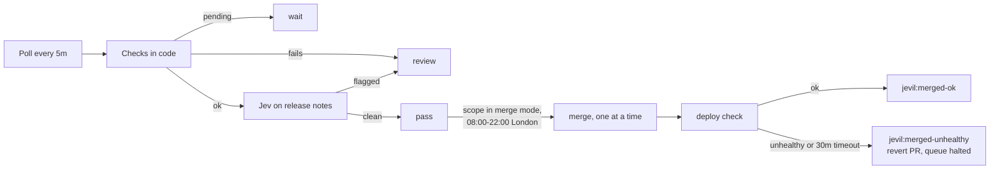

# Jevil

Renovate (Chore Bore) never merges. Jevil, `apps/jevil`, rules on every open Chore Bore pull
request, labels it, and merges the ones its policy passes, one at a time, checking each deploy
before the next. It acts on GitHub as `jevil-bot[bot]`. Source: `github.com/member87/jevil`
(private), image `ghcr.io/member87/jevil:<sha>`.

Checks in code decide what is eligible. Jev, TypeSafe's decision model called through OpenRouter,
reads the release notes and can only send an eligible pull request to review. Missing information
never passes.



## What passes

All of these, checked in code:

- The author and every commit are `chore-bore[bot]`, from a branch in this repository, into `main`.
- Every file is under one `apps/<app>` (plain manifests, not a Helm chart dir) or one
  `terraform/<workspace>` listed in the policy. Mixed scopes go to review.
- Every changed line is the same line with one version token swapped. Lockfile hash lines may
  come and go. Anything else (a new env var, an image repository change) goes to review.
- Every update in Renovate's table is `minor` or `patch`.
- Every commit status is green, and these exist: `Terrakube - homeops - aws-edge`,
  `Terrakube - homeops - grafana`, `renovate/stability-days`, and for Terraform the workspace's own
  context.
- Terraform: the workspace's plan summary is `0 to add, 0 to change, 0 to destroy`.
- Apps: the app's Flux Kustomization exists, has `wait: true` and is Ready.
- Release notes exist: Renovate's, or else the upstream GitHub releases between the two versions.
  Releases fetched that way must be at least 72 hours old.
- Jev answers each policy question inside its threshold: no breaking change, no manual upgrade
  step, no stored-data change, no text addressed to a bot, and a drop-in replacement.

Rulings are `pass`, `review` (a human decides) or `wait` (a status, release age or reconcile is
still pending; Jevil looks again next poll).

## What it writes on each pull request

- Labels, updated as soon as the ruling is made: `jevil:pass`, `jevil:review` or `jevil:waiting`,
  plus `scope:app|terraform`, `update:<type>`, and the reason labels `jevil:not-eligible`,
  `jevil:notes-missing`, `jevil:breaking`, `jevil:migration`, `jevil:data-risk`,
  `jevil:addressed-to-bot`. Jevil removes its own stale labels and never touches anyone else's.
- Commit status `jevil/policy` on the head commit (informational, not required by branch
  protection).
- One comment, edited in place: the reasons, Jev's probability per question, the model that
  answered, and the policy hash. It also caches Jev's answers, so an unchanged pull request is not
  asked again.

Commands, from logins in `commanders`, acknowledged with a 👍 reaction:

| Comment | Effect |
|---|---|
| `/jevil reclassify` | Ask Jev again even though nothing changed |
| `/jevil hold` | Add `jevil:hold`: never merge this pull request |
| `/jevil unhold` | Remove `jevil:hold` |

## Shadow mode and turning merging on

`modes` in `apps/jevil/policy.json` is `shadow` or `merge` per scope. In shadow mode Jevil labels
and comments but you merge. Both scopes start in shadow.

Switch a scope to `merge` once all of these hold:

- At least 4 weeks and 40 ruled pull requests in shadow, whichever is later.
- At least 95% agreement with what you did by hand.
- Not one pull request Jevil passed that you then closed unmerged or reverted. One resets the clock.
- `apps` first; `terraform` after 2 more weeks without a `jevil:merged-unhealthy`.

The counts are in Prometheus: `jevil_shadow_outcomes{ruling="pass|review",outcome="merged|closed"}`.
`pass`/`closed` is the number that must stay 0. Tune the thresholds and wording in `policy.json`
when a ruling is wrong; every policy change re-asks Jev on open pull requests.

## After a merge

Jevil adds `jevil:verifying` before merging (so a restart cannot lose the check) and merges
nothing else until the deploy settles:

- Apps: the Kustomization has applied the merge commit (or a later one) and is Ready. Ready False
  is unhealthy immediately.
- Terraform: the workspace's Terrakube status on the merge commit is success.
- Nothing within 30 minutes is unhealthy.

Healthy: `jevil:merged-ok`. Unhealthy: `jevil:merged-unhealthy`, a comment with the reason, the
**Jevil Merging Halted** alert on Discord, and a revert pull request labelled `jevil:revert` and
`jevil:hold`. Jevil never merges its own reverts. It skips the revert when `main` has changed the
same files since; revert by hand then.

To resume after fixing it: merge or close the revert, then remove `jevil:merged-unhealthy` from the
original pull request.

## Operations

```bash
kubectl -n jevil logs deploy/jevil                  # JSON log: rulings, merges, deploy checks
kubectl -n jevil port-forward deploy/jevil 8080     # curl localhost:8080/metrics
```

Dry run from a workstation (writes nothing; see the Jevil repo README):

```bash
kubectl proxy --port=8001 &
gh repo clone member87/jevil ../jevil
GITHUB_TOKEN=$(gh auth token) OPENROUTER_API_KEY=... KUBE_API_URL=http://127.0.0.1:8001 \
  go -C ../jevil run . -policy "$PWD/apps/jevil/policy.json" -dry-run 548 549
```

Secrets in `jevil-secrets`: `openrouter-api-key`, `app-id`, `private-key.pem` (the Jevil Bot
GitHub App: Contents, Pull requests, Issues and Commit statuses write; Metadata read; webhook off).
A leaked App key can merge to `main`; revoke it under the App's settings. The image pull secret
`jevil-ghcr-pull` holds a token with `read:packages` only.

Releasing Jevil: a push to `main` of `member87/jevil` builds `ghcr.io/member87/jevil:<sha>`; pin it
in `apps/jevil/deployment.yaml`.
