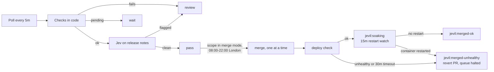

# Jevil

Jevil, `apps/jevil`, is the only thing that merges to `main`, for every pull request: a ruleset
blocks the GitHub merge button and `gh pr merge`, and you comment `/jevil merge` instead. It also
rules on every Chore Bore (Renovate) pull request, labels it, and on its own merges the ones its
policy passes, one at a time, checking each deploy before the next. It acts on GitHub as
`jevil-bot[bot]`. Source: `github.com/member87/jevil` (private), image `ghcr.io/member87/jevil:<sha>`.

## What a pull request changes

Every open pull request, from anyone, gets one Jevil comment **"what this changes"**, kept up to
date as commits land. Each changed file is mapped onto what deploys it:

| Target | When a file belongs to it | Deploys on merge |
|---|---|---|
| Flux Kustomization | under its `spec.path`; the most specific path wins (`infrastructure/metallb/config` over `infrastructure/metallb`) | yes |
| HelmRelease (Git chart) | under its chart directory (`apps/immich`, `charts/cert-manager`, ...) | only when `Chart.yaml` `version` changes; otherwise the comment says it deploys nothing |
| Terrakube workspace | under `terraform/<workspace>` | yes, Terrakube applies on merge |
| New app | under a new `apps/<app>` or `infrastructure/<x>` when the same pull request touches `flux/cluster` | yes, once Flux creates its Kustomization |
| tuppr upgrade | a `version:` bump in `infrastructure/tuppr/talos` or `/kubernetes` | yes: tuppr upgrades the nodes one at a time |
| Nothing | anything else (docs, scripts, `AGENTS.md`) | no |

The comment lists each target with the files under it and counts what will deploy. Under each Flux
target it shows the **object diff**: Jevil renders the Kustomization at the merge base and at the
head (kustomize, like kustomize-controller) and lists the objects added, removed and changed, with
the fields that change (`spec.template.spec.containers[name=grafana].image: 13.2.4 → 13.3.0`).
Secret and SealedSecret values are never shown. The merge comment, the deploy check and the "now
live" comment use the same targets.

## Checks

Every open pull request head gets the `jevil/checks` commit status and a **Checks** table in the
same comment. ❌ findings block `/jevil merge`; ⚠️ findings are for you to read.

| Check | Blocks on | Warns on |
|---|---|---|
| `secret` | a known token format on an added line (GitHub, OpenRouter/OpenAI/Anthropic, AWS, private keys, Slack, Discord webhooks, Tailscale, age, `user:pass@` URLs); a long random value whose key Jev judges a credential (≥ 0.7) | Jev 0.3-0.7; diffs too large to scan |
| `validate` | a target that does not build; `flux/cluster` not building or pointing at a missing directory; a changed object failing its schema (kubeconform: this cluster's own CRD schemas first, refreshed hourly, then Kubernetes schemas, then the community CRD catalog for kinds the cluster does not have) | schemas that could not be fetched |
| `lint` | a container or init container without a memory limit; an unpinned or `:latest` image; a namespaced object without `metadata.namespace`; a Deployment mounting a ReadWriteOnce PVC (looked up in the rendered targets) without `strategy.type: Recreate`, so a rollout onto another node waits on Multi-Attach; a file `kustomization.yaml` does not reference; a chart directory changed without a `Chart.yaml` bump; Longhorn image overrides; an frpc proxy, edge Caddy site and `public_hostnames` entry that disagree (only what the pull request introduces; `# jevil:edge-local` exempts a proxy only the edge uses); a new IngressRoute with a route that neither goes through a forwardAuth middleware nor only redirects to HTTPS, in an app with no OIDC configuration (`# jevil:auth <why>` exempts); a Talos minor bump to v1.N while `talos/patches` holds a patch marked `# jevil:before-boot v1.N` (apply it on every node, then `--allow lint`); a Kubernetes minor bump of the KubernetesUpgrade (v1.N → v1.M) while any Kustomization, rendered at the pull request's head, has an object whose apiVersion v1.N serves and v1.M does not, read from each release's OpenAPI spec (`flowcontrol.apiserver.k8s.io/v1beta3` FlowSchema at v1.32: the finding names the object and what v1.M still serves; move it there, or `--allow lint`) | a new app with an IngressRoute missing from Glance; a dashboard or alert reading a metric the Prometheus keep-list drops; a Talos minor bump with no patch marked for it (read the upgrade notes); a Kubernetes minor bump whose release API specs could not be fetched, or a Kustomization that does not build, so the removed-API check did not run for it |
| `destructive` | removing a PVC, PV, Namespace, HelmRelease, StatefulSet, CRD, Kustomization or FluxInstance; changing an immutable field (PVC spec, workload selectors, StatefulSet `volumeClaimTemplates`/`serviceName`, Service `clusterIP`, ...); dropping `kustomize.toolkit.fluxcd.io/prune: disabled`; shrinking a PVC; deleting every manifest of a Kustomization; removing a LoadBalancer Service, or changing what holds a LoadBalancer address: `type: LoadBalancer`, `loadBalancerIP` or a MetalLB `loadBalancerIPs`/`allow-shared-ip`/`address-pool` annotation, on a Service or in a HelmRelease's values (the Pi-hole NodePort outage) | |
| `image` | a new image tag or digest the registry does not have. A missing image is asked about again every poll, so a pull request opened while its image still builds clears on its own once the image is pushed | a registry that could not be asked |
| `health` (at merge time) | | waits while a node is NotReady, an attached Longhorn volume is not healthy, a TalosUpgrade/KubernetesUpgrade is not Completed, or a Kustomization other than the pull request's own targets is failing |
| `manual` | | a pull request touching `manualSteps.paths` (`infrastructure/`, `talos/`, `flux/`, the edge) that Jev, reading `AGENTS.md` and the diff, thinks needs a step by hand or a change elsewhere (≥ 0.5). Never asked when the secret check found anything, so a possible secret never leaves the cluster |

Only the changed objects are linted and validated, so an old problem elsewhere does not block an
unrelated pull request. Jev never sees a candidate secret's value: only the file, the key and the
value's shape (length, character classes, first three characters). Put `jevil:allow` in a comment
on a line to silence the secret check for it.

The removed-API check is the exception: a Kubernetes minor bump makes every manifest's
apiVersion matter, so it renders every Kustomization, not just the pull request's targets.
Objects a HelmRelease renders from its chart are not covered (Jevil does not render charts);
check the charts' upgrade notes before a minor bump.

After reviewing a finding, accept it for one merge with `--allow`:
`/jevil merge --allow destructive,image`. `--allow health` merges while the cluster is unhealthy.
A pull request touching a failing Kustomization or the tuppr manifests is exempt from those health
items, and so is a Kustomization failing only because it depends on one of the pull request's
targets (`dependency '...' is not ready`), so a fix can always merge.

## Merging a pull request: `/jevil merge`

Like the Aviator merge queue:

1. A login in `commanders` comments `/jevil merge` (optionally `--allow <checks>`). Jevil reacts 🚀,
   adds `jevil:queued` and replies with the head commit it queued (within a minute: it polls every
   `pollSeconds`).
2. Last readiness check, on a fresh read: the head is still that commit (a later push dequeues;
   comment again, except a Renovate rebase, below), not a draft, not on `jevil:hold`, into `main`, no merge conflict, no failing
   commit status, the required statuses (`Terrakube - homeops - aws-edge`, `- grafana`, plus the
   workspace of any changed `terraform/<workspace>`) reported success, no blocking check finding
   outside `--allow`, and the cluster is healthy. Pending checks and an unhealthy cluster keep it
   queued, with the reason added to the queue comment; anything failing takes it out of the queue
   with a comment saying why.
3. Jevil squash-merges it and comments with the merge commit and the targets that deploy it.
4. When all of those have applied the merge (see [After a merge](#after-a-merge)), it comments
   that the change is live. A pull request nothing deploys (docs, scripts) is done at the merge.

`/jevil revert` on a merged pull request opens a revert pull request (restoring each file and its
mode) and queues it in one step; it still goes through every check above.

Renovate rebases its own pull requests when they conflict. If Chore Bore rebases a queued pull
request and the change is the same, it stays queued at the new head. "The same" means the pull
request and every commit on it are still by `chore-bore[bot]`, it touches the same files, and
each file adds and removes the same lines (only where they land in the file moved). Jevil rewrites
the queue comment to the new head, keeping `--allow` and the schedule, says Renovate rebased it,
and runs the whole readiness check above on the new head before merging. Any other push,
including Renovate moving to a newer version, dequeues as before. Pull requests queued before
this change carry no fingerprint (`diff=` in the queue comment) and dequeue on any push.

One merge at a time: the queue waits while a deploy is being checked, oldest request first.
Commanded merges ignore the 08:00-22:00 window and Jevil's own `review` ruling (the command is the
human decision that ruling asks for). `/jevil cancel` takes a pull request out of the queue.

Scheduling, on the same command (they combine, in any order after `merge`):

- `at 03:00`: wait until the next 03:00 in the merge window's time zone (Europe/London), then
  merge if every check above passes.
- `after #570`: wait until #570 is merged and its deploy is live. If #570 is closed unmerged,
  turns `jevil:merged-unhealthy`, or waits for this pull request in turn, this one leaves the
  queue with a comment saying why.
- `--batch`: once one batch entry merges, every other batch entry ready in that poll merges right
  after it, and their deploys are checked together: one restart window instead of one each.
  Entries without `--batch` wait for the batch to go live.

`/jevil merge --batch at 03:00` on several pull requests merges all of them at 03:00. The schedule
is stored in the queue comment, so it survives restarts; `/jevil status` and the dashboard's
merge queue show it.

The block on manual merges is the `jevil-merges-only` repository ruleset: it restricts updates to
`main` and only the Jevil Bot App may bypass it. Break-glass when Jevil is down: an admin
disables the ruleset under Settings → Rules, merges, and enables it again.

Checks in code decide what a Chore Bore pull request may merge on its own (it must also pass the
checks and the health gate). Jev, TypeSafe's decision model called through OpenRouter, reads the
release notes and can only send an eligible pull request to review. Missing information never
passes.

A major (any update type the policy does not let merge on its own) is always ruled `review`,
but Jev still reads its release notes, Renovate's and the upstream project's, and answers the
same questions. The comment presents the answers as advice for your `/jevil merge` decision and
the reason labels (`jevil:breaking`, `jevil:migration`, ...) still apply. Release age does not
hold advice back, and notes over `notes.maxBytes` are cut rather than refused.

Before Jev reads the notes, paragraphs that also appear verbatim in the release the deployment
runs now are left out: projects repeat boilerplate in every release (Radarr's "If you are using
docker you will need to update the container image"), and Jev, seeing one release, would read it
as a step for this upgrade. The comment's notes line says how many were left out; the posted
changelog stays verbatim.

An update whose upstream target exists on GitHub only as prereleases (no stable release of that
version) is not eligible to merge on its own and gets `jevil:prerelease`: home-operations images
can track an application's develop channel, so a minor bump there can still be a test build.

`jevil:security` comes from a `labelOnly` question: Jev thinks the release fixes a security
vulnerability (≥ 0.5). It never sends an update to review; a ready one carrying it merges ahead of
other Renovate updates, and the dashboard's open pull request table shows it under flags.

Upstream issues: for every upstream project an update resolves to, Jevil searches the issues
opened there since the target version's release (the newest `upstreamIssues.maxIssues`, again
every `refreshMinutes`) and asks Jev about each one: did something that worked in the previous
version break in this one? Any single issue at ≥ 0.7 adds `jevil:regression` and sends the
update to review, naming the issue; that is what the release-age wait is for. Asking about all
issues at once made every bug report that names the version look like a regression (issue
templates ask for it). Jev is paid per call, so issues that cannot be a regression report
(feature, question, docs or translation labels; closed as not planned or duplicate) are skipped
unasked, only the `askPerUpstream` (10) most engaged are read, each issue is asked once (cached
by its title and body, also in the pull request comment, so restarts and polls cost nothing), and
`maxCallsPerDay` (200, about $0.04) caps the total. The comment says how many were read, skipped
and left unread. A failed search makes the ruling wait.

For Talos and Longhorn upgrades, Jev also answers the `upgradeNotes` questions in the policy
(machine-config changes before first boot, removed fields, upgrade path, Kubernetes support;
Longhorn manual steps, resources, upgrade path, removed settings) over up to
`upgradeNotesMaxBytes` of the upstream release notes. The answers are a section of the ruling
comment, flagged items marked "check before merging"; they never change the ruling.

Release notes come from Renovate's pull request body and from the upstream project: a
LinuxServer.io image resolves to its `project_url` (`linuxserver/docker-<app>/readme-vars.yml`),
a home-operations image to the `SOURCE` in `home-operations/containers/apps/<app>/docker-bake.hcl`,
so Jev reads Jellyfin's or Radarr's releases and not only the image's. Image versions map onto the
upstream's (`12.4ubu2604-ls57` → `12.4`, `2.7.0` matches `v2.7.0.5163`); a LinuxServer rebuild
that only moves `-lsN` is recorded as such. `upstreams` in the policy maps any other package to a
repository by hand. The comment lists which sources were read.



## What passes

All of these, checked in code:

- The author and every commit are `chore-bore[bot]`, from a branch in this repository, into `main`.
- Every file is under one `apps/<app>` (plain manifests, or a Helm wrapper chart listed in
  `eligibleCharts` with only `Chart.yaml` changed and its version bumped) or one
  `terraform/<workspace>` listed in the policy. Mixed scopes go to review.
- Every changed line is the same line with one version token swapped. Lockfile hash lines may
  come and go. Anything else (a new env var, an image repository change) goes to review.
- Every update in Renovate's table is `minor` or `patch`.
- Every commit status is green, and these exist: `Terrakube - homeops - aws-edge`,
  `Terrakube - homeops - grafana`, `renovate/stability-days`, and for Terraform the workspace's own
  context.
- Terraform: the workspace's plan summary is `0 to add, 0 to change, 0 to destroy`.
- Apps: the app's Flux Kustomization exists, has `wait: true` and is Ready; for an eligible chart,
  its HelmRelease is Ready.
- Release notes exist: Renovate's, or else the upstream GitHub releases between the two versions.
  Releases fetched that way must be at least 72 hours old.
- Jev answers each policy question inside its threshold: no breaking change, no manual upgrade
  step, no stored-data change, no text addressed to a bot. `drop_in` only flags below 0.3: Jev
  hedges around 0.5 on any update with a feature list, so a higher bar held every update.
- Jev finds no regression report among the issues opened upstream since the release.

Rulings are `pass`, `review` (a human decides) or `wait` (a status, release age or reconcile is
still pending; Jevil looks again next poll).

## What it writes on each pull request

- Labels, updated as soon as the ruling is made: `jevil:pass`, `jevil:review` or `jevil:waiting`,
  plus `scope:app|terraform`, `update:<type>`, and the reason labels `jevil:not-eligible`,
  `jevil:notes-missing`, `jevil:breaking`, `jevil:migration`, `jevil:data-risk`,
  `jevil:addressed-to-bot`. Jevil removes its own stale labels and never touches anyone else's.
- Commit status `jevil/policy` on the head commit (informational, not required by branch
  protection).
- One comment, edited in place: the reasons, Jev's probability per question, the model that
  answered, and the policy hash. It also caches Jev's answers, so an unchanged pull request is not
  asked again.
- In that comment, a collapsed **📜 Changelog** per upstream project Jevil fetched itself: every
  release between the two versions, newest first, so a missing Renovate changelog is not a trip
  to GitHub. Renovate's own notes stay in the pull request description and are not repeated.
  Capped at 12 KB a release and 45 KB a comment (cut at a line, with a link to the rest).
  Mentions are broken and issue references and links go through `redirect.github.com`, so the
  notes ping nobody and leave no cross-references on this repository's or upstream's issues.

Commands are accepted from the logins in `commanders` only; the policy sets that to `member87`
alone, and Jevil refuses to start with an empty list. Anyone else gets a 😕 and a refusal. Jevil
reads the first line of a comment as the command, so a note can follow on the next lines. After a
restart it reads on from where it stopped, but never further back than 24 hours: a command left
while Jevil was down for longer is not run unseen days later; comment it again. They
work on any open pull request; `/jevil revert` on a merged one:

| Comment | Effect |
|---|---|
| `/jevil merge` | Queue it for merge at its current head |
| `/jevil merge --allow destructive,image` | Same, accepting the blocking findings of those checks (`secret`, `validate`, `lint`, `destructive`, `image`, `health`) |
| `/jevil merge at 03:00` · `after #570` · `--batch` | Same, scheduled (see [Merging a pull request](#merging-a-pull-request-jevil-merge)) |
| `/jevil cancel` | Take it out of the queue |
| `/jevil revert` | On a merged pull request: open a revert pull request and queue it |
| `/jevil reclassify` | Ask Jev again and rerun the checks even though nothing changed |
| `/jevil status` | Reply with the ruling and its reasons, the checks, the queue position and what it waits for, the health gate for this pull request's targets and what it deploys; on a merged one, whether the deploy is live |
| `/jevil explain` | On a Chore Bore pull request: re-ask Jev with each part of the release notes left out (paragraphs, then down to one line inside the strongest) and reply with what drives each flagged answer. At most 40 Jev calls a pass, about $0.005 in all |
| `/jevil hold` | Add `jevil:hold` (and dequeue): never merge this pull request |
| `/jevil unhold` | Remove `jevil:hold` |

## Merge mode

`modes` in `apps/jevil/policy.json` is `shadow` or `merge` per scope. Both scopes are in `merge`:
a Chore Bore pull request Jevil rules `pass` (every check in [What passes](#what-passes), the
pre-merge checks and the health gate) merges on its own, between 08:00 and 22:00 London, one at
a time, after any `/jevil merge` requests. Anything else still waits for `/jevil merge`; a major
update always goes to review. In `shadow` Jevil labels and comments only.

They were switched on 2026-10-28 by decision, before the shadow criteria this section used to
set (4 weeks, 40 rulings, 95% agreement). Go back to `shadow` for a scope as soon as Jevil passes
something you would have closed: that is `jevil_shadow_outcomes{ruling="pass",outcome="closed"}`
(the **Passed but you closed it** panel) and any `jevil:merged-unhealthy`. Tune the thresholds and
wording in `policy.json` when a ruling is wrong; every policy change re-asks Jev on open pull
requests.

## After a merge

Jevil adds `jevil:verifying` before merging (so a restart cannot lose the check), comments on the
pull request with the merge commit and what it is waiting for, and merges nothing else until the
deploy settles:

- Flux: every Kustomization a changed file belongs to has applied the merge commit (or a later
  one) and is Ready. Ready False is unhealthy immediately. A new app waits until Flux has created
  its Kustomization.
- HelmRelease: a chart whose `Chart.yaml` version was bumped is Ready on that chart version.
- Terraform: each touched workspace's Terrakube status on the merge commit is success.
- tuppr: the TalosUpgrade (or KubernetesUpgrade) asks for the new version and reaches `Completed`.
  Jevil keeps one **Upgrade in progress** comment updated with the phase, nodes done and current
  node. Upgrades get `verify.upgradeTimeoutMinutes` (8h) instead of 30 minutes.
- Nothing within 30 minutes is unhealthy.

Ready is not the end: a readiness probe passing says nothing about the first real requests. Once
the deploy is Ready, Jevil posts the live comment, swaps `jevil:verifying` for `jevil:soaking`
(merged and live, still watched) and keeps the queue held for `verify.soakMinutes` (15). Each
poll it reads `kube_pod_container_status_restarts_total` from Prometheus for the pods of what the
merge deployed: the Deployments, StatefulSets, DaemonSets, Jobs and CronJobs in each
Kustomization's inventory, and every pod in the target namespace of a HelmRelease (Git-sourced
or in the inventory). A container restart since the merge (a crash, an OOM kill, a failing
liveness probe; the comment names the pod and its last exit reason) is unhealthy, as below.
Prometheus not answering keeps the watch going rather than passing it. Talos/Kubernetes upgrades
and Terraform-only merges are not watched. Remove `jevil:soaking` to end a watch early;
`/jevil status` on the merged pull request shows how long it has left.

Healthy: the live comment says which Kustomization applied which commit (or the Terrakube apply)
and, after the watch, that nothing restarted; plus `jevil:merged-ok`. Unhealthy: `jevil:merged-unhealthy`, a comment with the reason, the
**Jevil Merging Halted** alert on Discord, and a revert pull request labelled `jevil:revert` (not
for a failed Talos/Kubernetes upgrade: rolling nodes back is a human decision).
Jevil never merges a revert on its own: review it and comment `/jevil merge`; while merging is
halted only reverts can merge. It skips the revert when `main` has changed the
same files since; revert by hand then.

To resume after fixing it: `/jevil merge` or close the revert, then remove `jevil:merged-unhealthy` from the
original pull request.

## Pull requests Jevil opens

Jevil proposes changes as ordinary pull requests (label `jevil:proposal`). They get the same checks
and need `/jevil merge`: Jevil never merges its own. Closing one is a "no": that branch is not
proposed again for 30 days, and the same change (the same values, or the same entries removed)
never again; a different change on the branch is proposed after the 30 days. While one is open,
Jevil refreshes it only when its files would change.

**Right-sizing** (`jevil:right-size`, `rightSizing` in the policy): from Prometheus, each
container's p95 CPU and p95/max RSS over `lookbackDays` (90), needing `minDays` (5) of data,
against the requests in the plain manifests under `apps/<app>/` (`exclude`d apps, container names
not unique in their namespace and workloads a kustomize patch changes are skipped), and in the
values of the HelmReleases `rightSizing.helm` maps (below). Jevil looks every `everyHours` (24):
an app's proposal opens the day its containers qualify, and an open one is rewritten with newer
numbers at most every `refreshHours` (168). One pull request per app or release:

- CPU request target p95 × 1.25 (rounded up to 10m); proposed at 3× over and 100m more, or 1.5×
  under and 50m more.
- Memory request target RSS p95 × 1.2 (rounded up to 16Mi); proposed at 2× over and 128Mi more, or
  1.25× under and 64Mi more. Memory is sized from RSS, not the working set: the working set
  includes page cache the kernel reclaims before an OOM kill (sonarr's working set sits at its 2Gi
  limit with 365Mi RSS).
- A memory limit is raised only after an OOM kill (to max(max RSS × 1.5, limit × 1.25)) or when max
  RSS reaches 85% of it (to max RSS × 1.5); it is never lowered. CPU limits are never touched.
- A missing CPU request, memory request or memory limit is added (requests at the targets above,
  the limit at max RSS × 1.5 and at least the request): a container without a memory limit joins
  the Talos OOM ranking's protected tier. Nothing is added inside a `{flow: mapping}`.

`rightSizing.helm` names each chart-deployed container and where its resources sit in the
HelmRelease: `values` is the path under `spec.values` to the mapping that holds `resources` (""
for `spec.values.resources`), and `pod`, a regular expression on the pod name, tells containers
of the same name apart (Immich's server and machine learning are both `main`). A value edit there
deploys at once: no chart version bump.

Prometheus keeps size-capped history (32 GB, 90 days and more), and Jevil reads up to
`lookbackDays` of it; it never stores metrics itself. Proposals start once five days of
`container_memory_rss` are stored and lean on more history as it builds up.

Each right-size pull request opens with a dark-themed chart (PNG), one row per container: CPU (millicores)
and RSS (MiB) over the data held, each point the busiest moment of its step (30 minutes for a
couple of weeks of data, 3 hours for 90 days), with the p95 the rules
read, the request and limit now, and what the pull request sets (green; red for a raised limit).
An untouched limit more than 4× above everything else is named in the panel title instead of
flattening the use against the axis, and the line breaks where Prometheus has no data. Charts
are committed to the `jevil/charts` branch (no shared history with `main`, nothing deploys from
it) and linked by commit, so a later chart never changes an older pull request. They are drawn
only when the pull request is opened or its files change; if Prometheus or the upload fails the
body says so and the pull request opens on its table alone.

**Cleanup** (`jevil:cleanup`, weekly, `cleanup` in the policy), only configuration that points at
nothing: `renovate.json` `matchFileNames` paths that match no file (a rule goes only when all its
paths are gone and it has no other matcher); a parked app's entry in a disabled Renovate rule
once that app is scaled back up; Glance links under `lab.jackhumes.com` that no IngressRoute
serves. One pull request per kind and app (`jevil/cleanup/<app>/<kind>`), so each app's cleanup
is merged or closed on its own: the app is the `apps/<app>` a Renovate path names (else the path's
top directory, e.g. `infrastructure`) or the `<app>.lab.jackhumes.com` a Glance link points at. A
Renovate rule whose paths are all gone is removed whole by one of those pull requests, never split:
merged piecemeal, it would be left with an empty `matchFileNames`, which matches every file. Two
cleanups of the same file can conflict once one merges; the next weekly run rebuilds the other
from `main`.

The weekly cleanup also drops **config nothing uses** (`jevil/cleanup/<app>/unused-config`): a
ConfigMap, Secret or SealedSecret written in `apps/<app>` whose name appears in no other rendered
object of its namespace (env, volumes, envFrom, imagePullSecrets, a HelmRelease's values for that
namespace via `targetNamespace`) and nowhere in a wrapper chart's files. Its document goes; a file
left empty is deleted and dropped from `kustomization.yaml`. Flux prunes the object on merge. A
document with `# jevil:keep <why>` in it is never proposed, for config an app reads by other means.

**Volume growth** (`jevil:grow`, daily, `volumes` in the policy): a Longhorn PVC written in
`apps/<app>` that has been at least `above` (85%) full for `forDays` (3), by the kubelet's
`kubelet_volume_stats_*` in Prometheus, gets a request that leaves it `target` (60%) full, in
whole GiB and never less than 25% more; one pull request per app, with a chart of its use over
30 days. Longhorn grows a volume in place. PVCs here are create-only
(`kustomize.toolkit.fluxcd.io/ssa: IfNotPresent`), so the merge only records the size: the pull
request lists the `kubectl patch` that applies it. NFS-backed PVCs are never proposed.

**Re-vendoring** (`jevil:vendor`, daily, `vendor` in the policy): a manifest vendored whole from
upstream carries a marker, e.g.
`# jevil:vendor repo=metallb/metallb version=v0.16.1 url=https://raw.githubusercontent.com/metallb/metallb/{version}/config/manifests/metallb-native.yaml`,
with `only=`/`skip=` kinds when the file holds part of the upstream file (sealed-secrets splits
its CRD into `crds.yaml`). When the repository tags a newer `X.Y.Z`, Jevil fetches the upstream
file at both versions and carries upstream's changes onto the vendored one, object by object, so
local deviations (another namespace, a renamed ClusterRole, a reformatted Deployment) stay; where
the lines cannot merge, it applies upstream's changed values in place. One pull request per
directory, with the upstream release notes and comments that still name the old version. When
upstream's changes collide with local ones (both changed the same values, or upstream changed an
object renamed here) no pull request opens, and the daily report lists the file under **Vendored
manifests to re-vendor by hand**. Marked today: MetalLB, Sealed Secrets (install and CRDs) and
kube-network-policies. Traefik's `install.yaml` is assembled by hand and has no marker.

**Daily report** (issue "Jevil daily report", `jevil:report`, edited in place): first, **since the
last report**: what is new or gone in each section below compared with the last complete report.
Then parked apps
(every workload at `replicas: 0`, last change, volumes held), Longhorn volumes detached for over
`cleanup.detachedDays` (size, app, whether the PVC still exists), **resource use** (how many days
of use Prometheus holds, and every container the right-sizing rules find clearly over or under
its requests, with its open right-size pull request, or "not proposed yet" while it has under
`minDays` of data), **Jev thresholds**, and open cleanup pull requests. **Jev thresholds** reads
up to 300 Chore Bore pull requests closed in the last 90 days, leaving out the ones Renovate closed
itself as superseded (`- autoclosed`). It lists any that Jevil ruled `pass` and you then closed:
that is the evidence to go back to `shadow`. For each question that sends pull requests to review,
it uses Jev's last answer from the ruling comment and today's threshold to show the flagged pull
requests that were merged anyway (a flag you overrode) and those closed unmerged. It then gives
the `reviewAbove`/`reviewBelow` range that would have passed every merged one and still flagged
every closed one, or says that none separates them. Label-only questions (`security`) are not
listed. Change a threshold only once several pull requests point the same way. The report itself
opens nothing.
Right-sizing runs daily, cleanup weekly and the report daily; each runs on schedule across
restarts (right-sizing and cleanup first, so the report links what they opened). A section Jevil
could not read (Longhorn, Prometheus or the closed pull requests unreachable) says so in the issue, and the report is
written again every 10 minutes until it reads, instead of a day later. Report only:
Jevil never deletes apps, PVCs or volumes.

**One-click fixes**: when the checks find a lint problem Jevil can fix on a line the pull request
changes, it posts one review per head commit with GitHub suggestions (apply each, or batch them
under *Files changed*): `metadata.namespace` for a namespaced object without one (the app's
`Namespace`, else the directory name), a manifest missing from `kustomization.yaml` (when that
file is in the pull request), an unpinned or `:latest` image (pinned to the newest stable
`X.Y.Z` tag its registry lists), and `strategy.type: Recreate` for a Deployment the rollout lint
flags (a new `strategy:` after `replicas:`, or `type: RollingUpdate` rewritten when no
`rollingUpdate:` settings are set). Never on Chore Bore pull requests.

## State

Jevil keeps what it must remember across restarts in `/var/lib/jevil/state.db` (bbolt) on the
`jevil-state` PVC (1Gi Longhorn, ReadWriteOnce, backed up daily like other volumes); the single
replica and `Recreate` strategy free it before the next pod starts. It holds bookkeeping only:

| Bucket | What |
|---|---|
| `jobs` | when right-sizing, cleanup and the report last ran, so a restart does not run them early |
| `cursor` | where command comments were last read |
| `budget` | upstream-issue Jev calls today, against `maxCallsPerDay` |
| `answers`, `manual` | Jev's answers on upstream issues and manual-step diffs, for 30 days |
| `proposals` | the last change proposed on each proposal branch, and when |
| `report` | what the last complete report listed |
| `vendor` | upstream releases that collide with local changes, for the report |

Metrics are never stored: right-sizing, charts and the report read Prometheus each time. Losing
the file costs only what it remembers: jobs run on the next poll, Jev is asked again, and a
declined change could come back after its 30 days. Each failed read or write counts in
`jevil_state_errors_total` and is logged; it never stops a poll. Jevil refuses to start
without the file (`-state`); dry runs do not use it.

## Operations

Grafana dashboard **Jevil** (Infrastructure folder, `terraform/grafana/dashboards/infrastructure/jevil.json`):

- **Status**: last poll, halt state, mode per scope, open pull requests by ruling, errors.
- **Merge success** (30 days): the share of merges not rolled back, rollbacks, merges, the
  share of deploy checks that passed, and merges and rollbacks per day. A rollback is a revert
  pull request Jevil opened (`jevil_reverts_total`: `unhealthy` after a failed deploy check,
  `command` on `/jevil revert`); a revert done by hand is not counted, and merges of revert pull
  requests (`jevil_merges_total{kind="revert"}`) count as neither merge nor rollback.
- **Now**, rebuilt every poll: the merge queue in merge order with each entry's status and what it
  waits for; merged pull requests whose deploy Jevil is still watching (Flux, Terrakube, tuppr
  upgrades, with the current phase); the cluster health gate's problems; and every open pull
  request with author, ruling, checks summary and queue state. PR numbers link to GitHub.
- **History** (Loki): merges with commit, reason and targets, then when each went live or turned
  unhealthy; every comment Jevil posted or edited (kind and first line); every check run; one
  line per poll (duration, what it saw, what it merged, the error); comments per hour by kind.
- Rulings, labels, merges and deploy checks over time; Jev cost (24h, 30d, projected month, per
  call, cache hit rate); ruling accuracy; Jev's answers per open pull request; the raw activity
  log. Merges and unhealthy deploys show as annotations.

The live tables come from `jevil_queue_entry`, `jevil_watching`, `jevil_health_problem` and
`jevil_open_pull_request` (one series per row); the history from the `merged`, `deploy ok`,
`deploy unhealthy`, `dequeued`, `comment`, `report` and `cycle` log events.

```bash
kubectl -n jevil logs deploy/jevil                  # JSON log: rulings, merges, deploy checks
kubectl -n jevil port-forward deploy/jevil 8080     # curl localhost:8080/metrics
```

Dry run from a workstation (writes nothing; see the Jevil repo README):

```bash
kubectl proxy --port=8001 &
gh repo clone member87/jevil ../jevil
GITHUB_TOKEN=$(gh auth token) OPENROUTER_API_KEY=... KUBE_API_URL=http://127.0.0.1:8001 \
  go -C ../jevil run . -policy "$PWD/apps/jevil/policy.json" -dry-run 548 549
```

Secrets in `jevil-secrets`: `openrouter-api-key`, `app-id`, `private-key.pem` (the Jevil Bot
GitHub App: Contents, Pull requests, Issues and Commit statuses write; Metadata read; webhook off).
A leaked App key can merge to `main`; revoke it under the App's settings. The image pull secret
`jevil-ghcr-pull` holds a classic token with only `read:packages`, shared with
`tailscale-exit-node-manager-ghcr-pull`.

Releasing Jevil: a push to `main` of `member87/jevil` builds `ghcr.io/member87/jevil:<sha>`; pin it
in `apps/jevil/deployment.yaml`.
