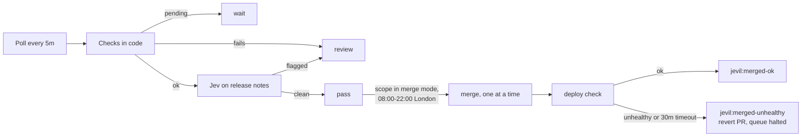

# Jevil

Jevil, `apps/jevil`, is the only thing that merges to `main`, for every pull request: a ruleset
blocks the GitHub merge button and `gh pr merge`, and you comment `/jevil merge` instead. It also
rules on every Chore Bore (Renovate) pull request, labels it, and on its own merges the ones its
policy passes, one at a time, checking each deploy before the next. It acts on GitHub as
`jevil-bot[bot]`. Source: `github.com/member87/jevil` (private), image `ghcr.io/member87/jevil:<sha>`.

## What a pull request changes

Every open pull request, from anyone, gets one Jevil comment **"what this changes"**, kept up to
date as commits land. Each changed file is mapped onto what deploys it:

| Target | When a file belongs to it | Deploys on merge |
|---|---|---|
| Flux Kustomization | under its `spec.path`; the most specific path wins (`infrastructure/metallb/config` over `infrastructure/metallb`) | yes |
| HelmRelease (Git chart) | under its chart directory (`apps/immich`, `charts/cert-manager`, ...) | only when `Chart.yaml` `version` changes; otherwise the comment says it deploys nothing |
| Terrakube workspace | under `terraform/<workspace>` | yes, Terrakube applies on merge |
| New app | under a new `apps/<app>` or `infrastructure/<x>` when the same pull request touches `flux/cluster` | yes, once Flux creates its Kustomization |
| tuppr upgrade | a `version:` bump in `infrastructure/tuppr/talos` or `/kubernetes` | yes: tuppr upgrades the nodes one at a time |
| Nothing | anything else (docs, scripts, `AGENTS.md`) | no |

The comment lists each target with the files under it and counts what will deploy. Under each Flux
target it shows the **object diff**: Jevil renders the Kustomization at the merge base and at the
head (kustomize, like kustomize-controller) and lists the objects added, removed and changed, with
the fields that change (`spec.template.spec.containers[name=grafana].image: 13.2.4 → 13.3.0`).
Secret and SealedSecret values are never shown. The merge comment, the deploy check and the "now
live" comment use the same targets.

## Checks

Every open pull request head gets the `jevil/checks` commit status and a **Checks** table in the
same comment. ❌ findings block `/jevil merge`; ⚠️ findings are for you to read.

| Check | Blocks on | Warns on |
|---|---|---|
| `secret` | a known token format on an added line (GitHub, OpenRouter/OpenAI/Anthropic, AWS, private keys, Slack, Discord webhooks, Tailscale, age, `user:pass@` URLs); a long random value whose key Jev judges a credential (≥ 0.7) | Jev 0.3-0.7; diffs too large to scan |
| `validate` | a target that does not build; `flux/cluster` not building or pointing at a missing directory; a changed object failing its schema (kubeconform: this cluster's own CRD schemas first, refreshed hourly, then Kubernetes schemas, then the community CRD catalog for kinds the cluster does not have) | schemas that could not be fetched |
| `lint` | a container or init container without a memory limit; an unpinned or `:latest` image; a namespaced object without `metadata.namespace`; a file `kustomization.yaml` does not reference; a chart directory changed without a `Chart.yaml` bump; Longhorn image overrides; an frpc proxy, edge Caddy site and `public_hostnames` entry that disagree (only what the pull request introduces; `# jevil:edge-local` exempts a proxy only the edge uses); a new IngressRoute with a route that neither goes through a forwardAuth middleware nor only redirects to HTTPS, in an app with no OIDC configuration (`# jevil:auth <why>` exempts); a Talos minor bump to v1.N while `talos/patches` holds a patch marked `# jevil:before-boot v1.N` (apply it on every node, then `--allow lint`) | a new app with an IngressRoute missing from Glance; a dashboard or alert reading a metric the Prometheus keep-list drops; a Talos minor bump with no patch marked for it (read the upgrade notes) |
| `destructive` | removing a PVC, PV, Namespace, HelmRelease, StatefulSet, CRD, Kustomization or FluxInstance; changing an immutable field (PVC spec, workload selectors, StatefulSet `volumeClaimTemplates`/`serviceName`, Service `clusterIP`, ...); dropping `kustomize.toolkit.fluxcd.io/prune: disabled`; shrinking a PVC; deleting every manifest of a Kustomization | |
| `image` | a new image tag or digest the registry does not have | a registry that could not be asked |
| `health` (at merge time) | | waits while a node is NotReady, an attached Longhorn volume is not healthy, a TalosUpgrade/KubernetesUpgrade is not Completed, or a Kustomization other than the pull request's own targets is failing |
| `manual` | | a pull request touching `manualSteps.paths` (`infrastructure/`, `talos/`, `flux/`, the edge) that Jev, reading `AGENTS.md` and the diff, thinks needs a step by hand or a change elsewhere (≥ 0.5). Never asked when the secret check found anything, so a possible secret never leaves the cluster |

Only the changed objects are linted and validated, so an old problem elsewhere does not block an
unrelated pull request. Jev never sees a candidate secret's value: only the file, the key and the
value's shape (length, character classes, first three characters). Put `jevil:allow` in a comment
on a line to silence the secret check for it.

After reviewing a finding, accept it for one merge with `--allow`:
`/jevil merge --allow destructive,image`. `--allow health` merges while the cluster is unhealthy.
A pull request touching a failing Kustomization or the tuppr manifests is exempt from those health
items, and so is a Kustomization failing only because it depends on one of the pull request's
targets (`dependency '...' is not ready`), so a fix can always merge.

## Merging a pull request: `/jevil merge`

Like the Aviator merge queue:

1. A login in `commanders` comments `/jevil merge` (optionally `--allow <checks>`). Jevil reacts 👍,
   adds `jevil:queued` and replies with the head commit it queued (within a minute: it polls every
   `pollSeconds`).
2. Last readiness check, on a fresh read: the head is still that commit (a later push dequeues;
   comment again), not a draft, not on `jevil:hold`, into `main`, no merge conflict, no failing
   commit status, the required statuses (`Terrakube - homeops - aws-edge`, `- grafana`, plus the
   workspace of any changed `terraform/<workspace>`) reported success, no blocking check finding
   outside `--allow`, and the cluster is healthy. Pending checks and an unhealthy cluster keep it
   queued, with the reason added to the queue comment; anything failing takes it out of the queue
   with a comment saying why.
3. Jevil squash-merges it and comments with the merge commit and the targets that deploy it.
4. When all of those have applied the merge (see [After a merge](#after-a-merge)), it comments
   that the change is live. A pull request nothing deploys (docs, scripts) is done at the merge.

`/jevil revert` on a merged pull request opens a revert pull request (restoring each file and its
mode) and queues it in one step; it still goes through every check above.

One merge at a time: the queue waits while a deploy is being checked, oldest request first.
Commanded merges ignore the 08:00-22:00 window and Jevil's own `review` ruling (the command is the
human decision that ruling asks for). `/jevil cancel` takes a pull request out of the queue.

The block on manual merges is the `jevil-merges-only` repository ruleset: it restricts updates to
`main` and only the Jevil Bot App may bypass it. Break-glass when Jevil is down: an admin
disables the ruleset under Settings → Rules, merges, and enables it again.

Checks in code decide what a Chore Bore pull request may merge on its own (it must also pass the
checks and the health gate). Jev, TypeSafe's decision model called through OpenRouter, reads the
release notes and can only send an eligible pull request to review. Missing information never
passes.

A major (any update type the policy does not let merge on its own) is always ruled `review`,
but Jev still reads its release notes, Renovate's and the upstream project's, and answers the
same questions. The comment presents the answers as advice for your `/jevil merge` decision and
the reason labels (`jevil:breaking`, `jevil:migration`, ...) still apply. Release age does not
hold advice back, and notes over `notes.maxBytes` are cut rather than refused.

Before Jev reads the notes, paragraphs that also appear verbatim in the release the deployment
runs now are left out: projects repeat boilerplate in every release (Radarr's "If you are using
docker you will need to update the container image"), and Jev, seeing one release, would read it
as a step for this upgrade. The comment's notes line says how many were left out; the posted
changelog stays verbatim.

An update whose upstream target exists on GitHub only as prereleases (no stable release of that
version) is not eligible to merge on its own and gets `jevil:prerelease`: home-operations images
can track an application's develop channel, so a minor bump there can still be a test build.

`jevil:security` comes from a `labelOnly` question: Jev thinks the release fixes a security
vulnerability (≥ 0.5). It never sends an update to review; a ready one carrying it merges ahead of
other Renovate updates, and the dashboard's open pull request table shows it under flags.

Upstream issues: for every upstream project an update resolves to, Jevil searches the issues
opened there since the target version's release (the newest `upstreamIssues.maxIssues`, again
every `refreshMinutes`) and asks Jev whether any reports a regression in that version. A yes
(≥ 0.5) adds `jevil:regression` and sends the update to review; that is what the release-age
wait is for. A failed search makes the ruling wait. The comment lists the newest issues.

For Talos and Longhorn upgrades, Jev also answers the `upgradeNotes` questions in the policy
(machine-config changes before first boot, removed fields, upgrade path, Kubernetes support;
Longhorn manual steps, resources, upgrade path, removed settings) over up to
`upgradeNotesMaxBytes` of the upstream release notes. The answers are a section of the ruling
comment, flagged items marked "check before merging"; they never change the ruling.

Release notes come from Renovate's pull request body and from the upstream project: a
LinuxServer.io image resolves to its `project_url` (`linuxserver/docker-<app>/readme-vars.yml`),
a home-operations image to the `SOURCE` in `home-operations/containers/apps/<app>/docker-bake.hcl`,
so Jev reads Jellyfin's or Radarr's releases and not only the image's. Image versions map onto the
upstream's (`12.4ubu2604-ls57` → `12.4`, `2.7.0` matches `v2.7.0.5163`); a LinuxServer rebuild
that only moves `-lsN` is recorded as such. `upstreams` in the policy maps any other package to a
repository by hand. The comment lists which sources were read.



## What passes

All of these, checked in code:

- The author and every commit are `chore-bore[bot]`, from a branch in this repository, into `main`.
- Every file is under one `apps/<app>` (plain manifests, not a Helm chart dir) or one
  `terraform/<workspace>` listed in the policy. Mixed scopes go to review.
- Every changed line is the same line with one version token swapped. Lockfile hash lines may
  come and go. Anything else (a new env var, an image repository change) goes to review.
- Every update in Renovate's table is `minor` or `patch`.
- Every commit status is green, and these exist: `Terrakube - homeops - aws-edge`,
  `Terrakube - homeops - grafana`, `renovate/stability-days`, and for Terraform the workspace's own
  context.
- Terraform: the workspace's plan summary is `0 to add, 0 to change, 0 to destroy`.
- Apps: the app's Flux Kustomization exists, has `wait: true` and is Ready.
- Release notes exist: Renovate's, or else the upstream GitHub releases between the two versions.
  Releases fetched that way must be at least 72 hours old.
- Jev answers each policy question inside its threshold: no breaking change, no manual upgrade
  step, no stored-data change, no text addressed to a bot, and a drop-in replacement.
- Jev finds no regression report among the issues opened upstream since the release.

Rulings are `pass`, `review` (a human decides) or `wait` (a status, release age or reconcile is
still pending; Jevil looks again next poll).

## What it writes on each pull request

- Labels, updated as soon as the ruling is made: `jevil:pass`, `jevil:review` or `jevil:waiting`,
  plus `scope:app|terraform`, `update:<type>`, and the reason labels `jevil:not-eligible`,
  `jevil:notes-missing`, `jevil:breaking`, `jevil:migration`, `jevil:data-risk`,
  `jevil:addressed-to-bot`. Jevil removes its own stale labels and never touches anyone else's.
- Commit status `jevil/policy` on the head commit (informational, not required by branch
  protection).
- One comment, edited in place: the reasons, Jev's probability per question, the model that
  answered, and the policy hash. It also caches Jev's answers, so an unchanged pull request is not
  asked again.
- In that comment, a collapsed **📜 Changelog** per upstream project Jevil fetched itself: every
  release between the two versions, newest first, so a missing Renovate changelog is not a trip
  to GitHub. Renovate's own notes stay in the pull request description and are not repeated.
  Capped at 12 KB a release and 45 KB a comment (cut at a line, with a link to the rest).
  Mentions are broken and issue references and links go through `redirect.github.com`, so the
  notes ping nobody and leave no cross-references on this repository's or upstream's issues.

Commands are accepted from the logins in `commanders` only; the policy sets that to `member87`
alone, and Jevil refuses to start with an empty list. Anyone else gets a 😕 and a refusal. Jevil
reads the first line of a comment as the command, so a note can follow on the next lines. They
work on any open pull request; `/jevil revert` on a merged one:

| Comment | Effect |
|---|---|
| `/jevil merge` | Queue it for merge at its current head |
| `/jevil merge --allow destructive,image` | Same, accepting the blocking findings of those checks (`secret`, `validate`, `lint`, `destructive`, `image`, `health`) |
| `/jevil cancel` | Take it out of the queue |
| `/jevil revert` | On a merged pull request: open a revert pull request and queue it |
| `/jevil reclassify` | Ask Jev again and rerun the checks even though nothing changed |
| `/jevil status` | Reply with the ruling and its reasons, the checks, the queue position and what it waits for, the health gate for this pull request's targets and what it deploys; on a merged one, whether the deploy is live |
| `/jevil explain` | On a Chore Bore pull request: re-ask Jev with each part of the release notes left out (paragraphs, then down to one line inside the strongest) and reply with what drives each flagged answer. At most 40 Jev calls a pass, about $0.005 in all |
| `/jevil hold` | Add `jevil:hold` (and dequeue): never merge this pull request |
| `/jevil unhold` | Remove `jevil:hold` |

## Merge mode

`modes` in `apps/jevil/policy.json` is `shadow` or `merge` per scope. Both scopes are in `merge`:
a Chore Bore pull request Jevil rules `pass` (every check in [What passes](#what-passes), the
pre-merge checks and the health gate) merges on its own, between 08:00 and 22:00 London, one at
a time, after any `/jevil merge` requests. Anything else still waits for `/jevil merge`; a major
update always goes to review. In `shadow` Jevil labels and comments only.

They were switched on 2026-10-28 by decision, before the shadow criteria this section used to
set (4 weeks, 40 rulings, 95% agreement). Go back to `shadow` for a scope as soon as Jevil passes
something you would have closed: that is `jevil_shadow_outcomes{ruling="pass",outcome="closed"}`
(the **Passed but you closed it** panel) and any `jevil:merged-unhealthy`. Tune the thresholds and
wording in `policy.json` when a ruling is wrong; every policy change re-asks Jev on open pull
requests.

## After a merge

Jevil adds `jevil:verifying` before merging (so a restart cannot lose the check), comments on the
pull request with the merge commit and what it is waiting for, and merges nothing else until the
deploy settles:

- Flux: every Kustomization a changed file belongs to has applied the merge commit (or a later
  one) and is Ready. Ready False is unhealthy immediately. A new app waits until Flux has created
  its Kustomization.
- HelmRelease: a chart whose `Chart.yaml` version was bumped is Ready on that chart version.
- Terraform: each touched workspace's Terrakube status on the merge commit is success.
- tuppr: the TalosUpgrade (or KubernetesUpgrade) asks for the new version and reaches `Completed`.
  Jevil keeps one **Upgrade in progress** comment updated with the phase, nodes done and current
  node. Upgrades get `verify.upgradeTimeoutMinutes` (8h) instead of 30 minutes.
- Nothing within 30 minutes is unhealthy.

Healthy: a second comment saying the change is live (which Kustomization applied which commit, or
the Terrakube apply) and `jevil:merged-ok`. Unhealthy: `jevil:merged-unhealthy`, a comment with the reason, the
**Jevil Merging Halted** alert on Discord, and a revert pull request labelled `jevil:revert` (not
for a failed Talos/Kubernetes upgrade: rolling nodes back is a human decision).
Jevil never merges a revert on its own: review it and comment `/jevil merge`; while merging is
halted only reverts can merge. It skips the revert when `main` has changed the
same files since; revert by hand then.

To resume after fixing it: `/jevil merge` or close the revert, then remove `jevil:merged-unhealthy` from the
original pull request.

## Operations

Grafana dashboard **Jevil** (Infrastructure folder, `terraform/grafana/dashboards/infrastructure/jevil.json`):

- **Status**: last poll, halt state, mode per scope, open pull requests by ruling, errors.
- **Now**, rebuilt every poll: the merge queue in merge order with each entry's status and what it
  waits for; merged pull requests whose deploy Jevil is still watching (Flux, Terrakube, tuppr
  upgrades, with the current phase); the cluster health gate's problems; and every open pull
  request with author, ruling, checks summary and queue state. PR numbers link to GitHub.
- **History** (Loki): merges with commit, reason and targets, then when each went live or turned
  unhealthy; every comment Jevil posted or edited (kind and first line); every check run; one
  line per poll (duration, what it saw, what it merged, the error); comments per hour by kind.
- Rulings, labels, merges and deploy checks over time; Jev cost (24h, 30d, projected month, per
  call, cache hit rate); ruling accuracy; Jev's answers per open pull request; the raw activity
  log. Merges and unhealthy deploys show as annotations.

The live tables come from `jevil_queue_entry`, `jevil_watching`, `jevil_health_problem` and
`jevil_open_pull_request` (one series per row); the history from the `merged`, `deploy ok`,
`deploy unhealthy`, `dequeued`, `comment`, `report` and `cycle` log events.

```bash
kubectl -n jevil logs deploy/jevil                  # JSON log: rulings, merges, deploy checks
kubectl -n jevil port-forward deploy/jevil 8080     # curl localhost:8080/metrics
```

Dry run from a workstation (writes nothing; see the Jevil repo README):

```bash
kubectl proxy --port=8001 &
gh repo clone member87/jevil ../jevil
GITHUB_TOKEN=$(gh auth token) OPENROUTER_API_KEY=... KUBE_API_URL=http://127.0.0.1:8001 \
  go -C ../jevil run . -policy "$PWD/apps/jevil/policy.json" -dry-run 548 549
```

Secrets in `jevil-secrets`: `openrouter-api-key`, `app-id`, `private-key.pem` (the Jevil Bot
GitHub App: Contents, Pull requests, Issues and Commit statuses write; Metadata read; webhook off).
A leaked App key can merge to `main`; revoke it under the App's settings. The image pull secret
`jevil-ghcr-pull` holds a classic token with only `read:packages`, shared with
`tailscale-exit-node-manager-ghcr-pull`.

Releasing Jevil: a push to `main` of `member87/jevil` builds `ghcr.io/member87/jevil:<sha>`; pin it
in `apps/jevil/deployment.yaml`.
